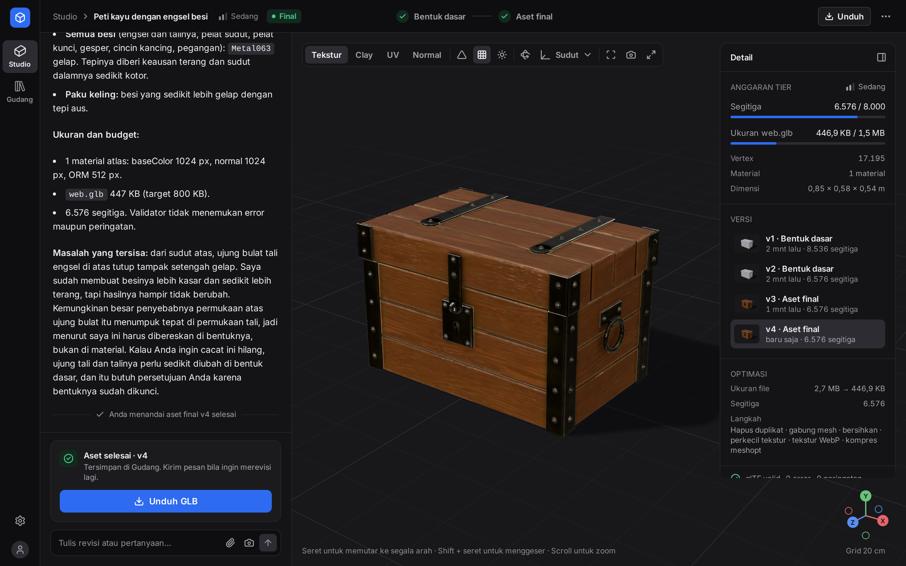

# Dokumentasi AI Asset Generate

Peta semua dokumen proyek: apa yang bisa dilakukan app, cara kerjanya, dan di mana mencari detailnya.

**AI Asset Generate** adalah app web lokal untuk satu pengguna yang membuat aset 3D `.glb` dari prompt dan gambar
referensi. Prosesnya:
1. Claude (lewat sesi login Claude Code) menulis skrip Blender.
2. Skrip dijalankan headless di sandbox Docker.
3. Claude melihat render-nya dan memperbaiki sendiri.
4. Anda menyetujui bentuk dasar abu-abu, lalu aset final bertekstur.

## Mulai dari mana?
| Saya ingin… | Baca |
|---|---|
| Memasang, menjalankan, update, backup, atau mengatasi masalah | [`README.md`](../README.md) di akar repo |
| Tahu fitur apa saja yang ada dan cara memakainya | [Panduan fitur](#panduan-fitur-untuk-pemakai) |
| Memahami cara kerja di balik layar | [Dokumentasi teknis](#dokumentasi-teknis-untuk-developer) |
| Mengubah atau menambah fitur | [Menambah fitur](teknis/09-menambah-fitur.md), lalu [`AGENTS.md`](../AGENTS.md) |

## Panduan fitur (untuk pemakai)
| Halaman | Isi |
|---|---|
| [Ikhtisar](fitur/01-ikhtisar.md) | App ini apa, alur dua tahap dari prompt sampai selesai, istilah, batas kemampuan |
| [Studio](fitur/02-studio.md) | Membuat aset: composer, lampiran, tier, thread, kartu pertanyaan, review, revisi, Stop |
| [Viewer 3D](fitur/03-viewer.md) | Mode Tekstur/Clay/UV/Normal, sudut kamera, gizmo, layar penuh, pintasan keyboard |
| [Gudang](fitur/04-gudang.md) | Cari, filter, urut, pilih banyak, ganti nama, duplikat, hapus, halaman detail aset |
| [Ekspor](fitur/05-ekspor.md) | Preset Web, Unity, Sumber; unduh ZIP banyak aset |
| [Pengaturan](fitur/06-pengaturan.md) | Akun Claude, model & effort, tier bawaan, budget, runtime 3D, tema, notifikasi |
| [Tier & budget](fitur/07-tier-dan-budget.md) | Ringan/Sedang/Maksimal: segitiga, material, tekstur, ukuran file |
| [Status & masalah](fitur/08-status-dan-masalah.md) | Banner, batas pemakaian, giliran gagal/terputus, halaman error, notifikasi |

## Dokumentasi teknis (untuk developer)
| Halaman | Isi |
|---|---|
| [Arsitektur](teknis/01-arsitektur.md) | Lapisan, arah dependensi, satu pintu per integrasi, alur satu giliran, struktur folder |
| [Claude Agent](teknis/02-claude-agent.md) | Sesi per aset, opsi SDK, tool `forge`, guard tiga lapis, prompt, driver palsu |
| [Runtime 3D](teknis/03-runtime-3d.md) | Image Docker + Blender, sandbox, `assetkit`, pipeline glTF, renderer, versi |
| [API & WebSocket](teknis/04-api.md) | Semua rute HTTP, kode error, protokol realtime dan jenis event |
| [Data](teknis/05-data.md) | Skema SQLite, mesin status aset, folder `data/`, pemeliharaan & backup |
| [Keamanan](teknis/06-keamanan.md) | Model ancaman, pagar jaringan, unggahan, sandbox, batas akses Claude, privasi log |
| [Frontend](teknis/07-frontend.md) | Rute web, data server, realtime, komponen, token & tema, aksesibilitas, viewer R3F |
| [Tes](teknis/08-tes.md) | Lapisan tes, matriks driver, perintah, golden image, E2E |
| [Menambah fitur](teknis/09-menambah-fitur.md) | Alur kerja bertahap, letak kode baru, checklist perubahan |

## Dokumen lain
| Dokumen | Isi |
|---|---|
| [`README.md`](../README.md) | Instalasi, menjalankan (termasuk systemd), update, backup/restore, pemecahan masalah |
| [`AGENTS.md`](../AGENTS.md) | Aturan pengembangan, perintah, jebakan yang sudah diketahui |
| [`PLAN.md`](PLAN.md) | Rencana bertahap (Tahap 0–12), lampiran teknis, Log keputusan |
| [`TECH_STACK.md`](TECH_STACK.md) | Library, versi, lisensi, alasan, opsi yang ditolak |
| [`progress/`](progress/README.md) | Laporan per tahap beserta bukti (screenshot, angka) |
| `runtime/knowledge/` | Referensi `assetkit` untuk Claude: [`API.md`](../runtime/knowledge/API.md), [`CONVENTIONS.md`](../runtime/knowledge/CONVENTIONS.md), cookbook |

## Menjaga dokumen tetap benar
- Perubahan fitur, API, skema, atau batas ikut memperbarui halaman terkait di folder ini (AGENTS §10).
- Angka yang bisa berubah ditulis bersama nama konstantanya di `shared/limits.ts`.
- Tes `tests/architecture/docs.test.ts` memastikan:
  - semua tautan relatif dan gambar di dokumen menunjuk file yang ada;
  - setiap halaman di `fitur/` dan `teknis/` terdaftar di indeks ini.
