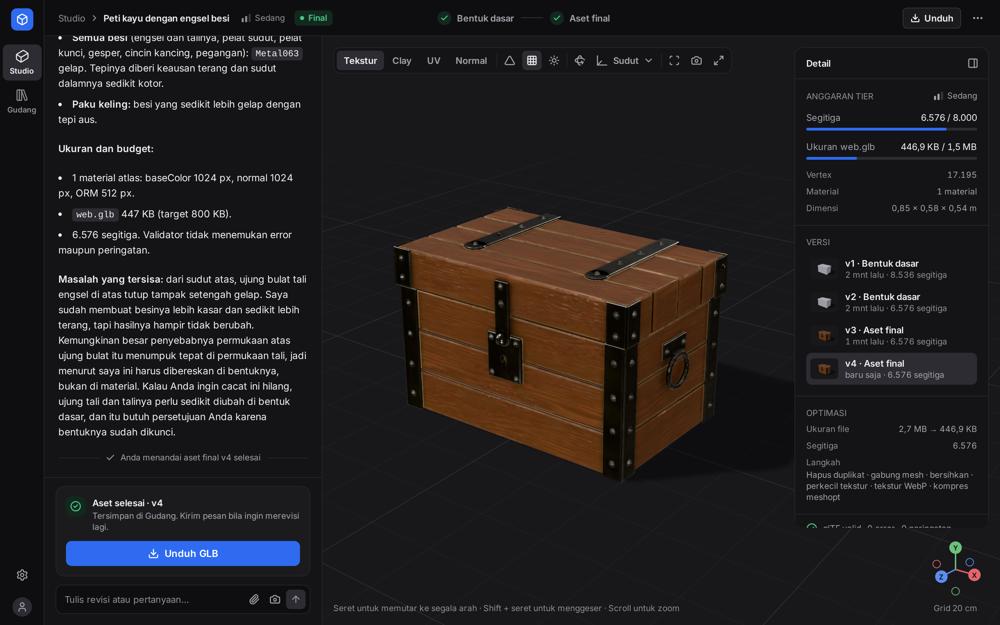
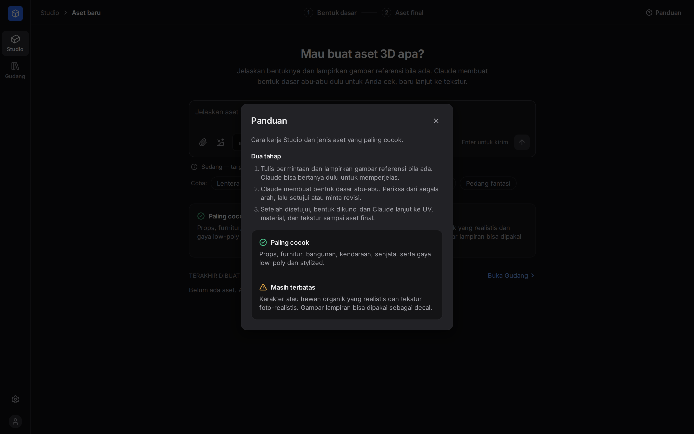
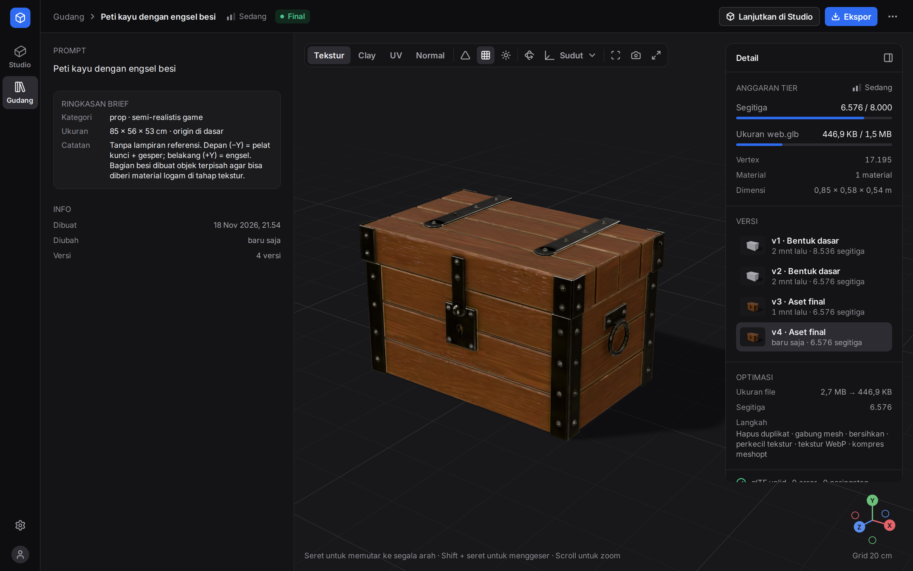

# Ikhtisar

AI Asset Generate membuat aset 3D `.glb` dari prompt dan gambar referensi, dalam dua tahap yang Anda setujui sendiri.

App ini berjalan lokal untuk satu pengguna. Claude (lewat sesi login Claude Code, tanpa API key) menulis skrip
Blender. Skrip itu dijalankan headless di container Docker. Claude melihat render hasilnya, lalu memperbaiki sendiri
sebelum menyerahkan versi untuk Anda review.

Instalasi, menjalankan app, backup, dan pemecahan masalah ada di [README](../../README.md).

## Halaman

| Halaman | Alamat | Isi |
|---|---|---|
| **Studio** | `/` | Composer untuk aset baru, kotak panduan, dan daftar **Terakhir dibuat** |
| Sesi Studio | `/studio/:assetId` | Percakapan dengan Claude, kartu dock, dan viewer 3D |
| **Gudang** | `/gudang` | Semua aset: cari, filter, pilih banyak, unduh ZIP |
| Detail aset | `/gudang/:assetId` | Info aset, viewer, dan ekspor |
| **Pengaturan** | `/pengaturan` | Akun Claude, model, budget tier, runtime 3D, tema, notifikasi |

Rel kiri berisi Studio, Gudang, dan Pengaturan, serta tombol **Akun** (avatar) dengan menu ringkas akun, tautan
Pengaturan, dan pilihan **Tema**. Titik kecil di ikon Studio berarti ada proses Claude yang sedang berjalan.

## Alur dua tahap

| Langkah | Yang terjadi | Status aset |
|---|---|---|
| 1. Kirim permintaan | Tulis prompt, lampirkan referensi, pilih tier, tekan **Kirim** | `BRIEFING` |
| 2. Brief | Claude bisa bertanya lewat kartu pertanyaan, lalu mencatat **Ringkasan brief** (kategori, ukuran, catatan) | `BRIEFING` → `BASE_WORKING` |
| 3. Bentuk dasar | Claude membangun bentuk abu-abu tanpa material, mengecek render 6 sudut, memperbaiki, lalu menyerahkan versi | `BASE_WORKING` |
| 4. Review bentuk dasar | Anda memeriksa dari segala arah, lalu **Setujui & lanjut tekstur** atau **Minta revisi** | `BASE_REVIEW` |
| 5. Tekstur | Bentuk dikunci. Claude membuat UV dan material; harness mem-bake tekstur ke satu atlas sesuai tier | `TEXTURE_WORKING` |
| 6. Review final | Anda memeriksa tekstur dan ukuran file, lalu **Selesai**, **Minta revisi**, atau **Ubah bentuk dasar** | `TEXTURE_REVIEW` |
| 7. Selesai | Aset tersimpan di Gudang dan bisa diekspor | `DONE` |

Setelah `DONE` Anda tetap bisa mengirim pesan revisi; aset kembali ke tahap tekstur. **Ubah bentuk dasar** membuka
lagi tahap bentuk dasar, dan tekstur dibuat ulang setelah bentuk baru disetujui.

Gerbang dua tahap ditegakkan di server (`server/domain/status.ts`), bukan hanya di tombol UI: Claude tidak bisa
membangun tekstur sebelum bentuk dasar disetujui.

## Istilah

| Istilah | Arti |
|---|---|
| Aset | Satu objek 3D beserta prompt, lampiran, percakapan, dan versinya |
| Versi `vN` | Hasil satu build yang diserahkan, bernomor urut (`v1`, `v2`, …). Isinya tidak pernah diubah setelah dibuat (write-once) |
| Bentuk dasar | Versi tahap 1: geometri abu-abu tanpa material dan tanpa UV |
| Aset final | Versi tahap 2: bertekstur, dioptimasi untuk web |
| Tahap | Indikator di topbar: **Bentuk dasar** → **Aset final** |
| Status | Badge aset: **Bentuk dasar**, **Aset final**, **Perlu review**, **Membuat…**, **Final**, **Gagal** |
| Tier | Kelas anggaran aset: **Ringan**, **Sedang**, **Maksimal**. Lihat [Tier dan budget](07-tier-dan-budget.md) |
| Kartu dock | Kartu di atas composer sesi yang menunjukkan keadaan aset dan aksi berikutnya |
| Thread | Percakapan di kolom kiri sesi: pesan Anda, balasan Claude, proses berpikir, progres build, kartu pertanyaan |

## Batas kemampuan

Isi dialog **Panduan** (tombol di topbar Studio) dan kotak panduan di halaman Studio:

| | |
|---|---|
| **Paling cocok** | Props, furnitur, bangunan, kendaraan, senjata, serta gaya low-poly dan stylized. |
| **Masih terbatas** | Karakter atau hewan organik yang realistis dan tekstur foto-realistis. Gambar lampiran bisa dipakai sebagai decal. |

Contoh hasil di halaman detail aset:

## Lihat juga
- [Studio](02-studio.md)
- [Viewer 3D](03-viewer.md)
- [Gudang](04-gudang.md)
- [Tier dan budget](07-tier-dan-budget.md)
- [Arsitektur](../teknis/01-arsitektur.md)
- [Claude Agent](../teknis/02-claude-agent.md)
