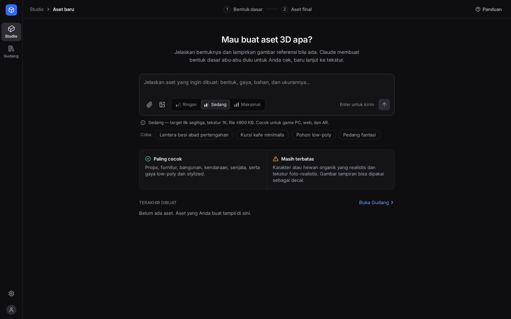
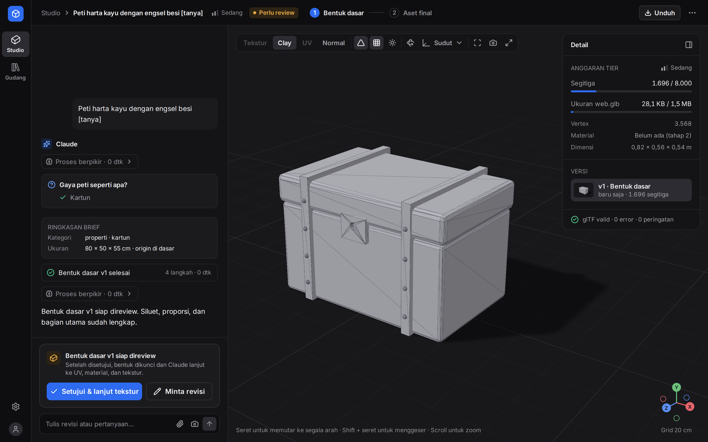
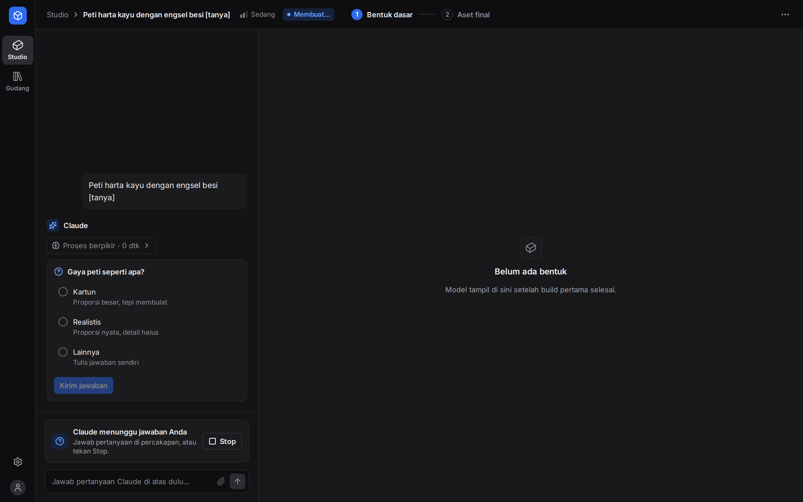
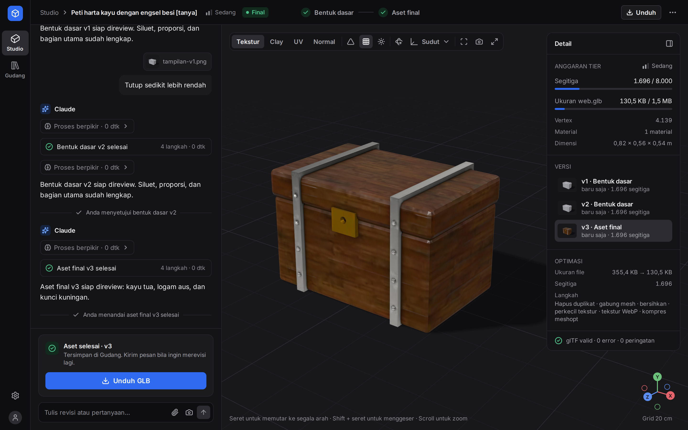

# Studio

Studio adalah tempat membuat aset baru dan bekerja bersama Claude sampai aset selesai.

## Aset baru (`/`)

Halaman ini berisi judul "Mau buat aset 3D apa?", composer, baris info tier, chip contoh (**Coba:**), kotak panduan
(**Paling cocok** / **Masih terbatas**), dan daftar **Terakhir dibuat**. Tombol **Panduan** di topbar membuka dialog
cara kerja dua tahap.

### Composer

| Bagian | Fungsi |
|---|---|
| Kolom prompt | Teks wajib diisi. Panjang maksimal `MESSAGE_MAX_CHARS` di `shared/limits.ts` (sekarang 8000 karakter) |
| Klip kertas (**Lampirkan gambar atau model 3D**) | Memilih gambar atau model 3D |
| **Tambah gambar referensi** | Memilih gambar saja |
| Pilihan **Tier** | **Ringan**, **Sedang**, **Maksimal** (tiga bar). Pilihan awal = **Tier bawaan** di Pengaturan |
| **Kirim** | Membuat aset lalu membuka sesinya. **Enter** mengirim, **Shift+Enter** membuat baris baru |

Di bawah composer tampil ringkasan tier, mis. "Sedang — target 8k segitiga, tekstur 1K, file ±800 KB. Cocok untuk game
PC, web, dan AR." Angkanya dibaca dari budget tier yang tersimpan di Pengaturan.

Chip contoh mengisi prompt (mis. **Kursi kafe minimalis**) lalu memindah fokus ke kolom prompt.

### Lampiran

Lampiran bisa ditambah dengan tiga cara: **tempel** (Ctrl+V di kolom teks), **seret** file ke composer ("Lepas file
di sini untuk melampirkan"), atau **pilih** lewat tombol. Setiap lampiran tampil sebagai chip dengan tombol hapus.

| Jenis | Format | Batas ukuran |
|---|---|---|
| Gambar | PNG, JPG, WebP, GIF | `ATTACHMENT_IMAGE_MAX_BYTES` (sekarang 20 MB) |
| Model 3D | GLB, glTF, OBJ, FBX, STL | `ATTACHMENT_MODEL_MAX_BYTES` (sekarang 50 MB) |

- Jumlah per pesan: `ATTACHMENT_MAX_FILES` (sekarang 8). Kelebihannya ditolak dengan toast "Maksimal 8 lampiran per
  pesan.".
- File yang jenisnya tidak dikenal atau terlalu besar ditolak lewat toast.
- Cek di browser hanya untuk umpan balik cepat. Server memeriksa ulang isi file (bukan ekstensinya), ukuran, dan
  jumlahnya. Gambar di-encode ulang dan metadatanya dibuang.

Semua batas di atas ada di `shared/limits.ts`.

### Terakhir dibuat

Empat aset yang terakhir diubah, masing-masing dengan thumbnail, badge status, dan waktu. Klik kartu untuk membuka
sesinya. **Buka Gudang** membuka daftar lengkap. Bila belum ada aset: "Belum ada aset. Aset yang Anda buat tampil di
sini."

## Sesi aset (`/studio/:assetId`)

Topbar berisi nama aset, tier, badge status, indikator tahap (**Bentuk dasar** → **Aset final**), tombol **Unduh**
(web.glb versi yang sedang dilihat), dan menu **Aksi aset** (**…**: **Ekspor…**, **Ganti nama…**, **Duplikat**,
**Hapus…**). Kolom kiri berisi thread dan dock; area kanan berisi [viewer 3D](03-viewer.md).

### Thread

| Blok | Isi |
|---|---|
| Pesan Anda | Teks dan lampiran yang Anda kirim |
| Baris aksi | Mis. "Anda menyetujui bentuk dasar v2", "Anda menghentikan proses" |
| Pesan Claude | Balasan Claude dalam Markdown, dikelompokkan per giliran di bawah kepala "Claude" |
| Proses berpikir | Tombol ringkas "Proses berpikir · durasi" (saat berjalan: "Sedang berpikir…"). Klik untuk membuka isinya |
| Ringkasan brief | **Kategori**, **Ukuran** (cm, origin di dasar), **Catatan** |
| Kartu build | Mis. "Membuat bentuk dasar v2", dengan langkah **Menulis skrip**, **Build di sandbox**, **Optimasi & cek budget**, **Render contact sheet**. Terbuka selama berjalan atau gagal; setelah selesai jadi satu baris "Bentuk dasar v1 selesai · 4 langkah · durasi" |
| Kartu pertanyaan | Lihat di bawah |
| Catatan | Pesan sistem, mis. setelah duplikat atau sesi dimulai ulang |
| Blok error | Lihat [Status dan masalah](08-status-dan-masalah.md) |

Penyebab build gagal ditulis di kartunya, mis. "Build gagal: skrip error", "melewati batas waktu",
"kehabisan memori", "glTF tidak valid", atau "bentuk bergeser dari yang disetujui". Claude biasanya langsung
memperbaiki dan membangun ulang.

Riwayat lama dimuat lewat **Muat pesan sebelumnya**.

### Kartu pertanyaan

Claude bisa bertanya sebelum atau di tengah pekerjaan.

- **Pilih satu** (radio) atau **pilih banyak** (kotak centang, dengan petunjuk "Pilih satu atau lebih.").
- Setiap pertanyaan punya opsi **Lainnya** ("Tulis jawaban sendiri") dengan isian teks, maksimal
  `OTHER_ANSWER_MAX_CHARS` (sekarang 2000 karakter). Enter di isian itu mengirim jawaban.
- Beberapa pertanyaan sekaligus dijawab dengan satu tombol **Kirim jawaban**, yang aktif setelah semuanya terjawab.
- Setelah dijawab, kartu menampilkan jawaban Anda. Bila dibatalkan (mis. lewat Stop): "Tidak dijawab · pertanyaan
  dibatalkan".

Selama pertanyaan terbuka, composer dikunci ("Jawab pertanyaan Claude di atas dulu…").

### Kartu dock

| Kartu | Kapan | Aksi |
|---|---|---|
| **Claude sedang bekerja** | Giliran Claude berjalan; menampilkan tahap, versi berikutnya, dan durasi | **Stop** |
| **Claude menunggu jawaban Anda** | Ada kartu pertanyaan terbuka | **Stop** |
| **Bentuk dasar vN siap direview** | Status `BASE_REVIEW` | **Setujui & lanjut tekstur**, **Minta revisi** |
| **Aset final vN siap direview** | Status `TEXTURE_REVIEW` | **Selesai**, **Minta revisi**, **Ubah bentuk dasar** |
| **Aset selesai · vN** | Status `DONE` | **Unduh GLB** (web.glb versi terkini) |
| **Giliran Claude gagal** | Giliran gagal saat tahap masih dikerjakan (tidak sedang review atau selesai) | **Coba lagi** |
| **Proses Claude terputus** | Server berhenti di tengah giliran | **Lanjutkan** |

- **Stop** menghentikan giliran Claude dan build yang berjalan. Thread mencatat "Dihentikan.".
- **Setujui & lanjut tekstur** mengunci bentuk; Claude lanjut ke UV, material, dan tekstur.
- **Minta revisi** memindah fokus ke composer. Pesan apa pun yang Anda kirim saat review juga dihitung sebagai revisi.
- **Ubah bentuk dasar** membuka dialog "Ubah bentuk dasar?" dengan isian wajib "Apa yang perlu diubah?", lalu
  **Ubah bentuk**. Claude membuat bentuk dasar baru dari versi yang disetujui; tekstur dibuat ulang setelah bentuk baru
  disetujui.
- **Coba lagi** dan **Lanjutkan** meneruskan dari titik terakhir.

### Revisi

Composer dock ("Tulis revisi atau pertanyaan…") selalu ada di bawah kartu dock. Selain klip kertas, ada tombol kamera
**Sertakan tampilan viewport**: tampilan viewer sekarang (sudut dan mode yang sama) dilampirkan sebagai
`tampilan-vN.png`. Gunakan untuk menunjuk bagian yang perlu diubah.

Setiap pesan Anda membuka giliran baru dan mengatur ulang jatah build per pesan (lihat
[Tier dan budget](07-tier-dan-budget.md)).

### Panel detail

Panel **Detail** melayang di kanan viewer. Isinya sama di sesi Studio dan Detail aset.

| Bagian | Isi |
|---|---|
| **Anggaran tier** | Meter **Segitiga** (terhadap target tier) dan **Ukuran web.glb** (terhadap maks tier). Kuning bila lewat target, merah bila lewat maks |
| Statistik | **Vertex**, **Material** (bentuk dasar: "Belum ada (tahap 2)"), **Dimensi** dalam meter |
| **Versi** | Semua versi dengan thumbnail, mis. "v3 · Aset final · 1 mnt lalu · 6.576 segitiga". Klik untuk melihat versi itu |
| **Optimasi** | Hanya aset final: ukuran file sumber → web.glb, segitiga, dan langkah pipeline (mis. hapus duplikat, gabung mesh, perkecil tekstur, tekstur WebP, kompres meshopt) |
| Validasi | "glTF valid · 0 error · 0 peringatan" atau "glTF tidak valid · …" |

Tombol panel di kepala panel menutupnya; tombol yang sama di pojok viewer membukanya lagi.

## Lihat juga
- [Ikhtisar](01-ikhtisar.md)
- [Viewer 3D](03-viewer.md)
- [Ekspor](05-ekspor.md)
- [Tier dan budget](07-tier-dan-budget.md)
- [Status dan masalah](08-status-dan-masalah.md)
- [Claude Agent](../teknis/02-claude-agent.md)
- [Runtime 3D](../teknis/03-runtime-3d.md)
