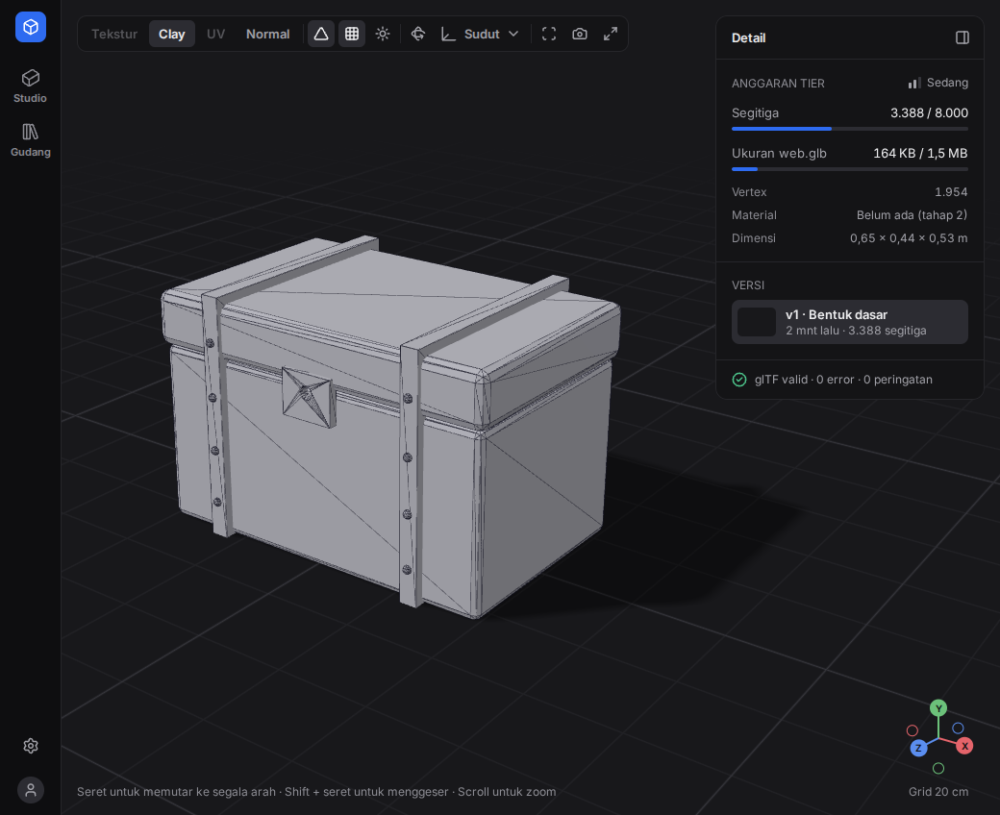
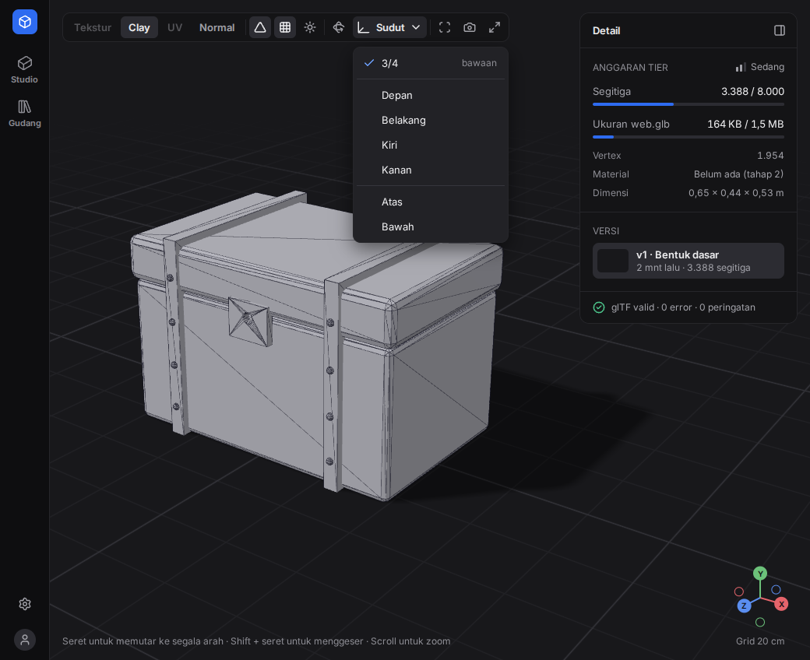

# Viewer 3D

Viewer menampilkan `web.glb` versi yang dipilih di sesi Studio dan di Detail aset.

Toolbar ada di kiri atas, panel **Detail** di kanan atas, gizmo sumbu dan keterangan grid (mis. "Grid 20 cm") di
kanan bawah, dan petunjuk kontrol di kiri bawah: "Seret untuk memutar ke segala arah · Shift + seret untuk menggeser ·
Scroll untuk zoom".

## Mode tampilan

| Mode | Isi | Tersedia bila |
|---|---|---|
| **Tekstur** | Material dan tekstur asli aset | Model punya material (aset final) |
| **Clay** | Material abu-abu polos, untuk menilai bentuk | Selalu |
| **UV** | Pola kotak di atas UV: regangan dan sambungan UV terlihat dari ukuran dan arah kotak | Semua mesh punya UV |
| **Normal** | Warna arah normal permukaan | Selalu |

Bawaan per tahap:

| Tahap versi | Mode awal | Wireframe awal |
|---|---|---|
| Bentuk dasar | **Clay** | Aktif |
| Aset final | **Tekstur** | Mati |

Bentuk dasar diekspor tanpa material dan tanpa UV, jadi **Tekstur** dan **UV** nonaktif saat mereview bentuk dasar.
Saat berganti versi ke tahap lain, mode dan wireframe ikut bawaan tahap itu; grid, cahaya, dan putar otomatis tetap.

## Toolbar

| Tombol | Fungsi | Pintasan |
|---|---|---|
| **Wireframe** | Garis segitiga di atas mode apa pun | `W` |
| **Grid lantai** | Grid di bawah model (aktif secara bawaan) | `G` |
| **Cahaya ikut kamera** | Lampu utama ikut berputar bersama kamera; bila mati, lampu tetap di tempatnya | `L` |
| **Putar otomatis** | Model berputar terus | `R` |
| **Sudut** | Menu sudut kamera: **3/4** (bawaan), **Depan**, **Belakang**, **Kiri**, **Kanan**, **Atas**, **Bawah** | |
| **Fokus ke model** | Membingkai ulang seluruh model | `F` |
| **Ambil gambar tampilan** | Menyimpan tampilan sekarang sebagai PNG (nama file dari nama aset) | |
| **Layar penuh** / **Keluar dari layar penuh** | Viewer memenuhi layar | `Escape` untuk keluar |

Bila sistem meminta animasi dikurangi (`prefers-reduced-motion`), **Putar otomatis** tidak tersedia dan tooltip-nya
menjelaskan alasannya. Perpindahan kamera juga tidak dianimasikan.

## Mouse

| Gerakan | Fungsi |
|---|---|
| Seret | Memutar ke segala arah |
| Shift + seret | Menggeser |
| Scroll | Zoom |
| Klik dua kali di permukaan model | Fokus ke titik itu dan mendekat |

## Gizmo sumbu

Gizmo menunjukkan arah sumbu X, Y, Z. Setiap bulatan adalah tombol: klik untuk melihat dari arah itu (mis. **Lihat
dari depan (+Z)**). Bulatan positif berlabel, bulatan negatif berupa lingkaran kosong.

## Pintasan keyboard

Semua pintasan huruf hanya berlaku saat fokus ada di dalam viewer, dan tidak saat mengetik atau berada di menu.
Tombol yang ditahan tidak mengulang toggle. Kombinasi Ctrl, Alt, atau Meta dibiarkan untuk browser.

| Tombol | Saat fokus di | Fungsi |
|---|---|---|
| `R` | Viewer | Putar otomatis aktif/mati |
| `F` | Viewer | Fokus ke model |
| `W` | Viewer | Wireframe aktif/mati |
| `G` | Viewer | Grid lantai aktif/mati |
| `L` | Viewer | Cahaya ikut kamera aktif/mati |
| Panah kiri/kanan | Area model (kanvas) | Memutar 15° (`KEYBOARD_ROTATE_STEP` di `web/features/viewer/math.ts`) |
| Panah atas/bawah | Area model | Memiringkan 15° |
| Shift + panah | Area model | Menggeser |
| `+` / `=` | Area model | Zoom masuk |
| `-` / `_` | Area model | Zoom keluar |
| Panah | Gizmo sumbu | Pindah antarbulatan (urutan X, Y, Z, −X, −Y, −Z); gizmo hanya satu pemberhentian Tab |
| `Enter` / `Spasi` | Bulatan gizmo | Lihat dari arah itu |
| `Escape` | Layar penuh | Keluar dari layar penuh |

Pintasan didefinisikan di `web/features/viewer/shortcuts.ts`.

## Panel detail

Panel **Detail** berisi anggaran tier, statistik, daftar versi, bagian optimasi (aset final), dan hasil validasi glTF.
Rinciannya ada di [Studio › Panel detail](02-studio.md#panel-detail). Panel bisa ditutup (**Tutup panel detail**) dan
dibuka lagi (**Buka panel detail**). Saat panel terbuka, pusat pandang kamera digeser ke area yang tidak tertutup panel.

## Keadaan khusus

| Tampilan | Arti |
|---|---|
| **Belum ada bentuk** | Belum ada versi; model tampil setelah build pertama selesai |
| "Memuat model…" | GLB sedang dimuat. Saat ganti versi, adegan lama tetap tampil sampai versi baru siap |
| **Model gagal dimuat** | GLB tidak bisa dibaca. Tekan **Coba lagi** |
| **Tampilan 3D terhenti** | Browser menghentikan WebGL (biasanya memori grafis penuh). Tekan **Muat ulang viewer** |
| **WebGL tidak tersedia** | Browser tidak bisa menampilkan 3D. Aktifkan akselerasi grafis atau pakai browser lain |

## Lihat juga
- [Studio](02-studio.md)
- [Gudang](04-gudang.md)
- [Frontend](../teknis/07-frontend.md)
