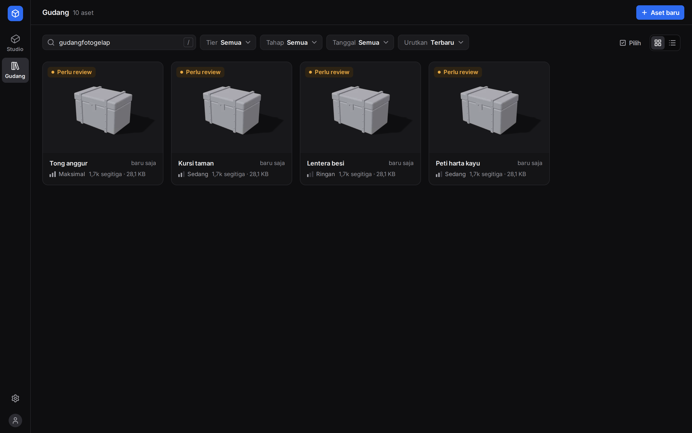
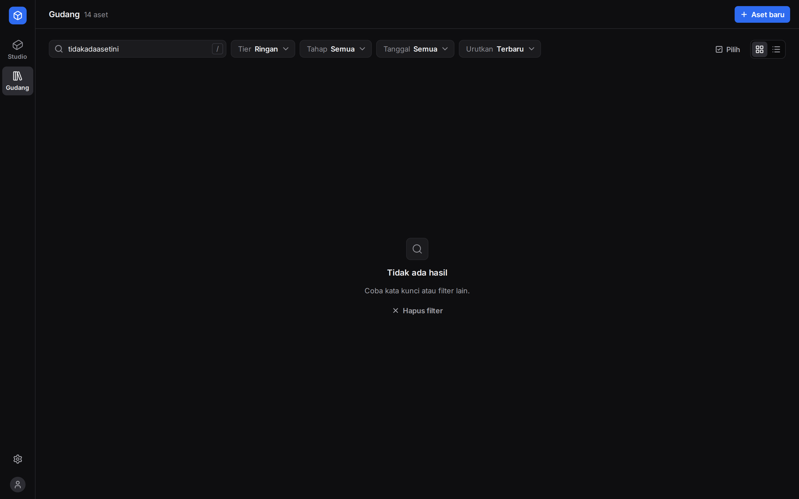
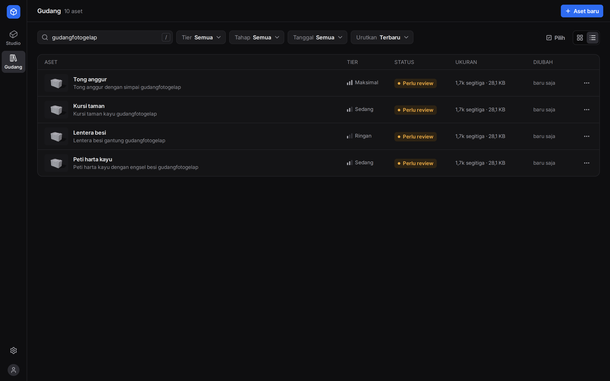
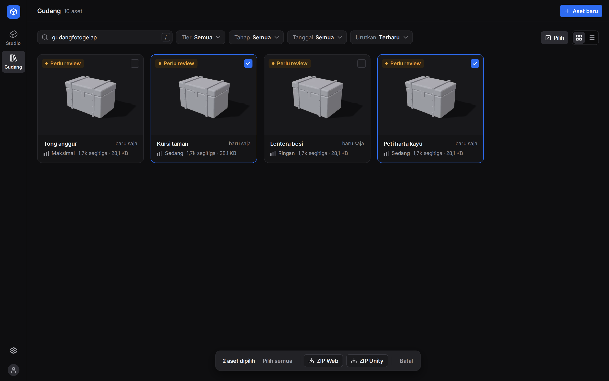
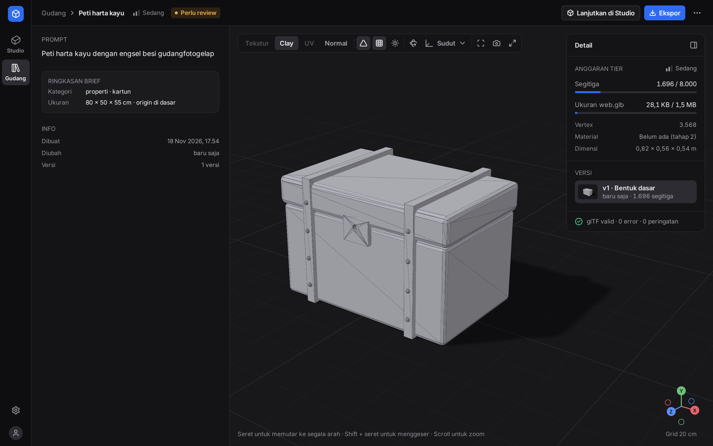

# Gudang

Gudang menampilkan semua aset: cari, filter, urutkan, buka detail, dan unduh banyak aset sekaligus.

## Cari, filter, dan urutkan

| Kontrol | Pilihan |
|---|---|
| **Cari aset** | Mencocokkan nama, prompt, atau kategori brief. Maksimal `ASSET_SEARCH_MAX_CHARS` (sekarang 100 karakter). Tekan `/` di mana saja di halaman untuk langsung ke kolom cari |
| **Tier** | **Semua**, **Ringan**, **Sedang**, **Maksimal** |
| **Tahap** | **Semua**, **Bentuk dasar** (termasuk brief dan review bentuk dasar), **Aset final** (sedang dikerjakan atau direview), **Selesai** |
| **Tanggal** | **Semua**, **24 jam terakhir**, **7 hari terakhir**, **30 hari terakhir** (berdasarkan waktu terakhir diubah) |
| **Urutkan** | **Terbaru**, **Terlama** (terakhir diubah), **Nama A–Z** |
| **Tampilan** | **Grid** atau **Daftar** |

Pilihan cari, filter, urut, dan tampilan disimpan di URL (mis. `/gudang?q=peti&tier=sedang&view=list`), jadi tetap
sama saat kembali dari Detail aset. Daftar menampilkan paling banyak `ASSET_LIST_MAX` aset (sekarang 500), tanpa
paginasi.

Bila tidak ada yang cocok: **Tidak ada hasil** dengan tombol **Hapus filter**. Bila belum ada aset sama sekali:
**Belum ada aset**.

## Grid

Setiap kartu berisi thumbnail versi terkini, badge status, nama, tier, waktu, dan info ringkas:

| Info | Arti |
|---|---|
| "3,4k segitiga · 612 KB" | Segitiga dan ukuran web.glb versi terkini |
| "Tahap 2 · 62%" | Build sedang berjalan, dengan bar progres |
| "Belum ada versi" | Belum ada build yang selesai |

Saat kartu disorot mouse atau difokus keyboard, thumbnail berputar 360° (strip turntable `TURNTABLE_FRAMES` frame,
sekarang 24) dan chip **360°** tampil. Bila sistem meminta animasi dikurangi, putaran tidak ditampilkan.

Klik kartu untuk membuka Detail aset.

## Daftar

Kolom: **Aset** (thumbnail, nama, prompt), **Tier**, **Status**, **Ukuran**, **Diubah**, dan **Aksi**. Kolom Aksi
berisi menu **…** per aset:

| Aksi | Hasil |
|---|---|
| **Lanjutkan di Studio** | Membuka sesi aset di Studio |
| **Ekspor…** | Dialog ekspor versi terkini (nonaktif bila belum ada versi). Lihat [Ekspor](05-ekspor.md) |
| **Ganti nama…** | Nama baru, wajib diisi, maksimal `ASSET_NAME_MAX_CHARS` (sekarang 80 karakter). Nama menjadi awal nama file ekspor |
| **Duplikat** | Salinan lengkap bernama "… (salinan)": status, brief, versi, lampiran, dan folder kerja. Riwayat percakapan tidak ikut; pesan pertama ke salinan membuka sesi Claude baru dengan ringkasan keadaan aset |
| **Hapus…** | Konfirmasi **Hapus aset**. Aset beserta versi, lampiran, dan riwayat percakapannya dihapus permanen. Proses Claude yang berjalan untuk aset itu ikut dihentikan |

Menu yang sama ada di topbar sesi Studio dan Detail aset.

## Pilih banyak dan unduh ZIP

1. Tekan **Pilih**. Kotak centang muncul di setiap kartu atau baris.
2. Pilih aset (klik di mana saja pada kartu), atau **Pilih semua** untuk semua aset yang tampil. Aset tanpa versi
   tidak bisa dipilih.
3. Tekan **ZIP Web** atau **ZIP Unity**. Isinya versi terkini setiap aset, satu GLB per aset.
4. **Batal** keluar dari mode pilih.

Satu ZIP memuat paling banyak `EXPORT_ZIP_MAX_ASSETS` aset (sekarang 100); di atas itu tombol ZIP nonaktif. Detail
format ada di [Ekspor](05-ekspor.md#unduh-zip-banyak-aset).

Gudang tidak punya hapus massal; aset dihapus satu per satu lewat menu **…**.

## Detail aset (`/gudang/:assetId`)

| Bagian | Isi |
|---|---|
| Topbar | Breadcrumb **Gudang** › nama (kembali ke daftar dengan filter terakhir), tier, badge status, **Lanjutkan di Studio**, **Ekspor**, menu **…** (**Ganti nama…**, **Duplikat**, **Hapus…**) |
| **Info aset** | **Prompt** dan semua lampiran (termasuk yang dikirim saat revisi), **Ringkasan brief**, lalu **Dibuat**, **Diubah**, **Versi** |
| Viewer | Viewer 3D dan panel **Detail** yang sama dengan Studio; pilih versi lain di panel |

**Ekspor** mengekspor versi yang sedang dilihat. **Lanjutkan di Studio** membuka sesi aset untuk merevisi atau
melanjutkan tahap berikutnya.

Bila aset dihapus dari tab lain, halaman menampilkan **Aset sudah dihapus**; alamat yang salah menampilkan **Aset
tidak ditemukan** dengan tombol **Kembali ke Gudang**.

## Lihat juga
- [Ekspor](05-ekspor.md)
- [Studio](02-studio.md)
- [Viewer 3D](03-viewer.md)
- [Data](../teknis/05-data.md)
- [API](../teknis/04-api.md)
