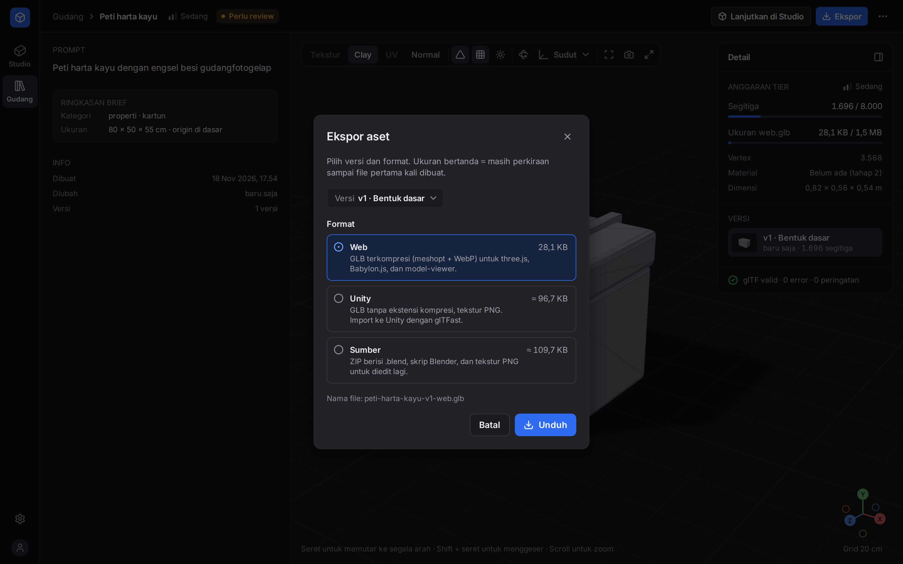

# Ekspor

Ekspor menyimpan satu versi aset dalam format siap pakai, atau versi terkini banyak aset sekaligus dalam satu ZIP.

## Dialog ekspor

Dialog **Ekspor aset** dibuka dari tombol **Ekspor** di Detail aset atau dari **Ekspor…** di menu **…** (Gudang
tampilan daftar, sesi Studio, Detail aset).

| Bagian | Isi |
|---|---|
| **Versi** | Semua versi aset, terbaru di atas. Awalnya versi yang sedang dilihat (atau versi terkini) |
| **Format** | Tiga preset di bawah, masing-masing dengan ukuran file |
| Nama file | "Nama file: …", berubah mengikuti versi dan format |
| **Batal** / **Unduh** | Unduh menyiapkan file lalu menyimpannya. Menutup dialog di tengah proses membatalkan unduhan |

Ukuran bertanda ≈ masih perkiraan, karena file Unity dan Sumber baru dibuat saat pertama kali diunduh. Setelah itu
file disimpan di cache `derived/vN/` aset, dan ukurannya tampil pasti. Cache yang tidak dipakai
`EXPORT_CACHE_STALE_MS` (sekarang 30 hari) dibuang otomatis dan dibuat ulang saat diunduh lagi.

## Preset

| Preset | Isi | Format | Ukuran | Nama file |
|---|---|---|---|---|
| **Web** | `web.glb` versi itu: geometri terkompresi meshopt, tekstur WebP. Untuk three.js, Babylon.js, dan model-viewer | GLB | Pasti (file sudah ada) | `<nama>-vN-web.glb` |
| **Unity** | GLB tanpa ekstensi kompresi, tekstur PNG/JPEG. Import ke Unity dengan glTFast tanpa paket tambahan | GLB | ≈ ukuran GLB sumber versi, sampai dibuat | `<nama>-vN-unity.glb` |
| **Sumber** | ZIP untuk diedit lagi di Blender (isi di bawah) | ZIP | ≈ jumlah isi, sampai dibuat | `<nama>-vN-sumber.zip` |

`<nama>` adalah nama aset dalam huruf kecil, hanya huruf dan angka dipisah `-`, maksimal `EXPORT_NAME_MAX_CHARS`
(sekarang 60 karakter); lihat `exportFileName` di `shared/export.ts`. Contoh: `peti-kayu-v4-unity.glb`.

### Unity

Sumbernya GLB versi sebelum optimasi web (`base.glb` atau `final.glb`). Ekstensi yang butuh dekoder tambahan di Unity
(meshopt, Draco, kuantisasi, KTX2, WebP, AVIF) dibuang atau diubah: tekstur WebP/AVIF menjadi PNG. Hasilnya divalidasi
ulang dan wajib 0 error (`server/pipeline/unity.ts`).

### Sumber

Folder `<nama>-vN-sumber/` di dalam ZIP:

| File | Isi |
|---|---|
| `README.md` | Isi folder, peringatan keamanan `.blend`, perintah untuk menjalankan ulang skrip, dan prompt aset |
| `scene.blend` | Adegan Blender 5.2 setelah build, gambar dikemas di dalamnya (bila tersedia untuk versi itu) |
| `script.py` | Bentuk dasar: skrip bentuk. Aset final: skrip material |
| `base.py` | Skrip bentuk dasar yang disetujui (aset final) |
| `budget.json` | Budget tier aset saat dibuat (aset final) |
| `textures/*.png` | Tekstur hasil bake dari GLB versi itu (aset final) |
| `stats.json` | Statistik, budget, dan hasil validator |

Saat membuka `scene.blend`, jangan izinkan Blender menjalankan skrip Python di dalam file. Adegan ini tidak
membutuhkannya, dan app sudah membuang skrip otomatis sebelum menyimpan.

## Unduh ZIP banyak aset

Dari mode **Pilih** di [Gudang](04-gudang.md): **ZIP Web** atau **ZIP Unity**.

| Hal | Aturan |
|---|---|
| Versi | Versi terkini setiap aset; aset tanpa versi tidak bisa dipilih |
| Isi | Satu GLB per aset, tanpa folder. Nama unik walau nama aset sama: `peti-v1-web.glb`, `peti-2-v1-web.glb` |
| Nama ZIP | `gudang-<jumlah>-aset-<web\|unity>.zip` |
| Batas | `EXPORT_ZIP_MAX_ASSETS` di `shared/limits.ts` (sekarang 100 aset per ZIP) |

Sebelum unduhan dimulai, server memeriksa semua aset dan membuat GLB Unity yang belum ada (tombol menampilkan
memuat). Kesalahan pemeriksaan tampil sebagai toast "ZIP gagal dibuat"; unduhan lalu di-stream langsung ke file.
Preset Sumber tidak tersedia untuk ZIP banyak aset.

## Unduh cepat

| Tombol | File |
|---|---|
| **Unduh** di topbar sesi Studio | web.glb versi yang sedang dilihat |
| **Unduh GLB** di kartu "Aset selesai" | web.glb versi terkini |
| **Ambil gambar tampilan** di toolbar viewer | PNG tampilan viewer saat ini |

## Lihat juga
- [Gudang](04-gudang.md)
- [Tier dan budget](07-tier-dan-budget.md)
- [Runtime 3D](../teknis/03-runtime-3d.md)
- [API](../teknis/04-api.md)
