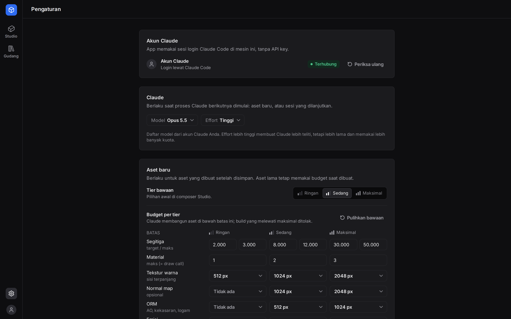
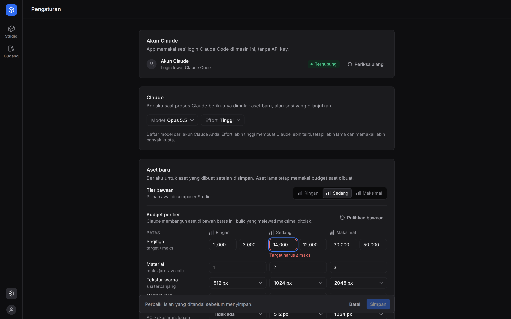
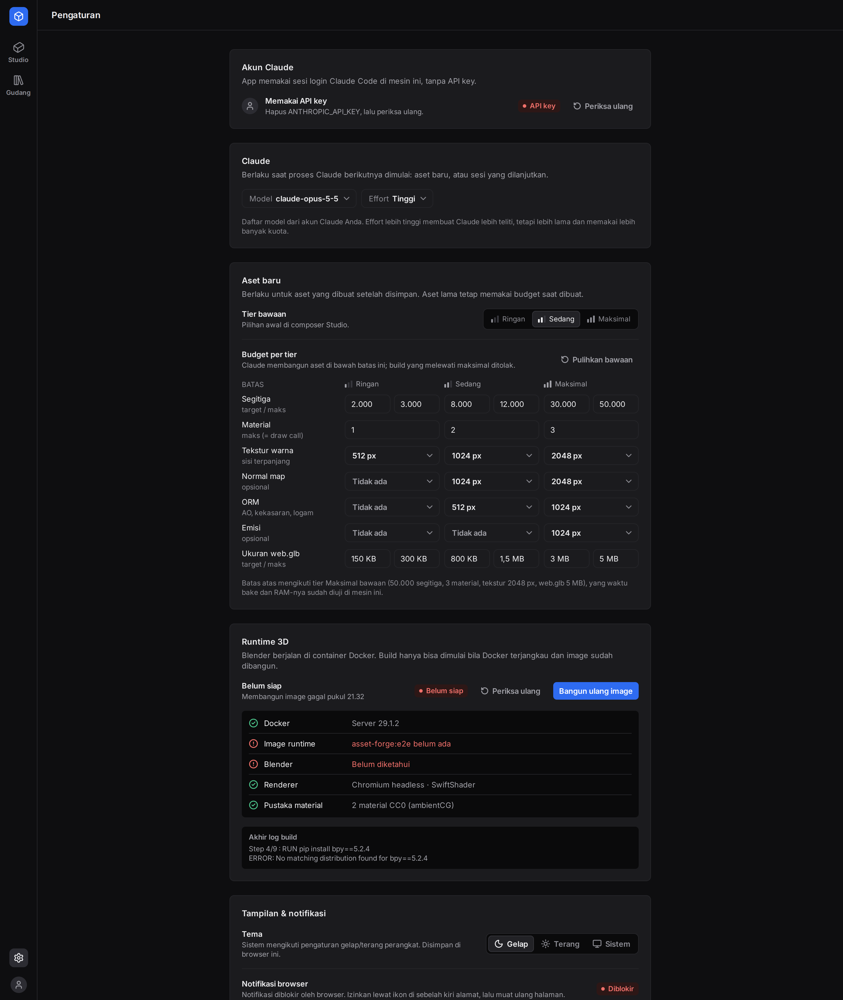

# Pengaturan

Pengaturan (`/pengaturan`) mengatur akun Claude, model, tier dan budget aset baru, runtime 3D, tema, dan notifikasi.

Bagian **Akun Claude** dan **Runtime 3D** dibaca terpisah dari pengaturan tersimpan, jadi tetap tampil walau salah
satunya gagal dimuat. Perubahan di bagian **Claude** dan **Aset baru** baru berlaku setelah disimpan lewat bilah simpan
di bawah: "Ada perubahan yang belum disimpan." dengan **Batal** dan **Simpan**.

## Akun Claude

App memakai sesi login Claude Code di mesin ini, tanpa API key.

| Status | Arti dan tindakan |
|---|---|
| Badge **Terhubung** | Login baik |
| **Belum login** | Jalankan `claude` di terminal mesin ini, lalu ketik `/login` |
| **API key** | Hapus `ANTHROPIC_API_KEY`, lalu periksa ulang |
| **Tidak berjalan** | Claude Code tidak bisa dijalankan; pesan error-nya tampil di baris akun |

**Periksa ulang** meminta pemeriksaan baru (melewati cache server). Pemeriksaan bisa butuh beberapa detik.

Catatan: email dan jenis paket akun **disembunyikan sementara**. Akun yang login tampil sebagai "Akun Claude · Login
lewat Claude Code", di sini dan di menu **Akun** rel. Pengaturnya `SHOW_ACCOUNT_IDENTITY` di `web/lib/health.ts`
(sekarang `false`).

## Claude

Berlaku saat proses Claude berikutnya dimulai: aset baru, atau sesi yang dilanjutkan.

| Isian | Isi |
|---|---|
| **Model** | Daftar model dari akun Claude Anda. Model tersimpan yang tidak ada di daftar tetap ditampilkan dengan id-nya |
| **Effort** | **Rendah**, **Sedang**, **Tinggi**, **Sangat tinggi**, **Maksimal**, sebatas yang didukung model. Effort lebih tinggi lebih teliti, tetapi lebih lama dan memakai lebih banyak kuota |

Bawaan ada di `shared/settings.ts`: `DEFAULT_MODEL` (sekarang `claude-opus-5-5`) dan `DEFAULT_EFFORT` (sekarang
`high`). Saat ganti model, effort dipertahankan bila didukung; bila tidak, menjadi **Tinggi** atau level tertinggi
model itu.

## Aset baru

Berlaku untuk aset yang dibuat setelah disimpan. Aset lama tetap memakai budget saat dibuat.

| Isian | Isi |
|---|---|
| **Tier bawaan** | Pilihan awal tier di composer Studio. Bawaan `DEFAULT_TIER_ID` (sekarang **Sedang**) |
| **Budget per tier** | Tabel batas tiap tier. **Pulihkan bawaan** mengisi tabel dengan `DEFAULT_TIERS` (tetap perlu **Simpan**) |

Baris tabel budget: **Segitiga** (target / maks), **Material** (maks, = draw call), **Tekstur warna**, **Normal map**,
**ORM** (AO, kekasaran, logam), **Emisi**, dan **Ukuran web.glb** (target / maks).

Aturan validasi (dicek saat mengetik, lalu dicek ulang di server dengan skema `TierBudgets` di `shared/settings.ts`):

| Isian | Aturan | Pesan bila salah |
|---|---|---|
| Segitiga, material | Bilangan bulat; pemisah ribuan boleh ("8.000", "8000") | "Isi bilangan bulat." |
| Ukuran web.glb | Dalam KB atau MB desimal (1 KB = 1000 byte), mis. "150 KB", "1,5 MB" | "Tulis dalam KB atau MB." |
| Semua angka | Di dalam `TIER_BUDGET_LIMITS` (lihat [Tier dan budget](07-tier-dan-budget.md)) | "Minimal …" / "Maksimal …" |
| Target dan maks | Target ≤ maks | "Target harus ≤ maks." |
| Tekstur | Pilih dari `TEXTURE_SIZE_OPTIONS` (256, 512, 1024, 2048 px). **Tekstur warna** wajib; slot lain boleh **Tidak ada** | |

Selama ada isian yang salah, bilah simpan menampilkan "Perbaiki isian yang ditandai sebelum menyimpan." dan **Simpan**
nonaktif.

## Runtime 3D

Blender berjalan di container Docker. Build hanya bisa dimulai bila Docker terjangkau dan image sudah dibangun.

| Ringkasan | Badge |
|---|---|
| **Siap dipakai** · "Diperiksa jam" | **Siap** |
| **Belum siap** · "Membangun image sejak jam" | **Membangun** |
| **Belum siap** · Docker tidak terjangkau / Image belum dibangun / "Membangun image gagal pukul jam" | **Belum siap** |

Daftar pemeriksaan: **Docker**, **Image runtime**, **Blender**, **Renderer**, **Pustaka material**, masing-masing lolos
atau bermasalah dengan keterangannya. Dalam mode fixture (tanpa Docker) keterangannya "Mode fixture · tanpa Docker".

| Tombol | Kapan tampil |
|---|---|
| **Periksa ulang** | Selalu |
| **Bangun image** | Docker terjangkau, image belum ada, dan tidak sedang membangun |
| **Bangun ulang image** | Seperti di atas, setelah build image terakhir gagal |

Build image berjalan di latar (biasanya beberapa menit) dan selesainya terlihat tanpa memuat ulang halaman. Bila gagal,
kotak **Akhir log build** menampilkan ekor log-nya.

## Tampilan & notifikasi

| Isian | Isi |
|---|---|
| **Tema** | **Gelap**, **Terang**, **Sistem** (mengikuti perangkat). Disimpan di browser ini. Juga bisa diubah di menu **Akun** rel |
| **Notifikasi browser** | **Izinkan notifikasi** meminta izin browser. Status: **Aktif**, **Diblokir** (izinkan lewat ikon di kiri alamat, lalu muat ulang), atau **Tidak didukung** |

Notifikasi browser muncul saat aset siap direview, selesai, gagal, atau butuh jawaban, dan hanya ketika tab app tidak
sedang dilihat. Lihat [Status dan masalah](08-status-dan-masalah.md#toast-dan-notifikasi-browser).

## Lihat juga
- [Tier dan budget](07-tier-dan-budget.md)
- [Status dan masalah](08-status-dan-masalah.md)
- [README: instalasi dan pemecahan masalah](../../README.md#pemecahan-masalah)
- [Claude Agent](../teknis/02-claude-agent.md)
- [Runtime 3D](../teknis/03-runtime-3d.md)
