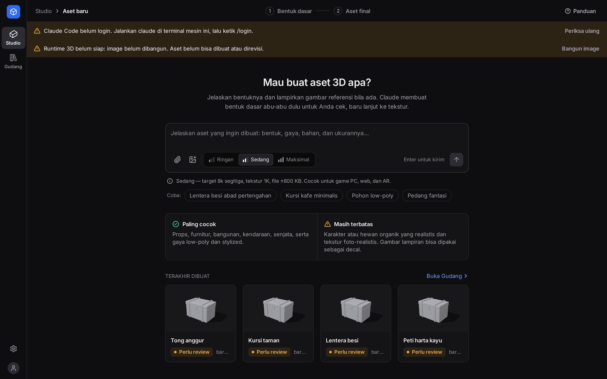
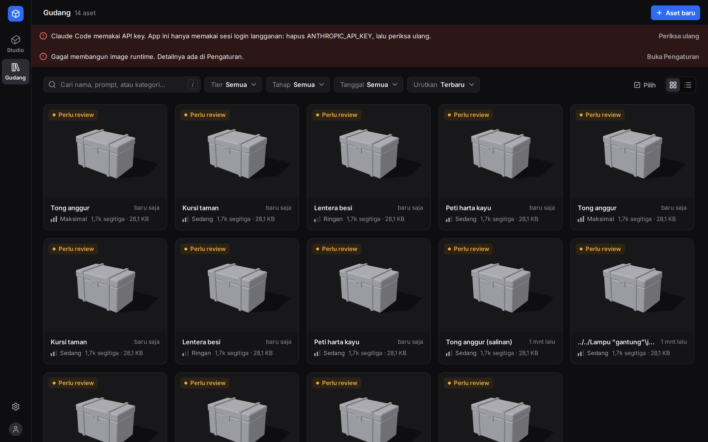
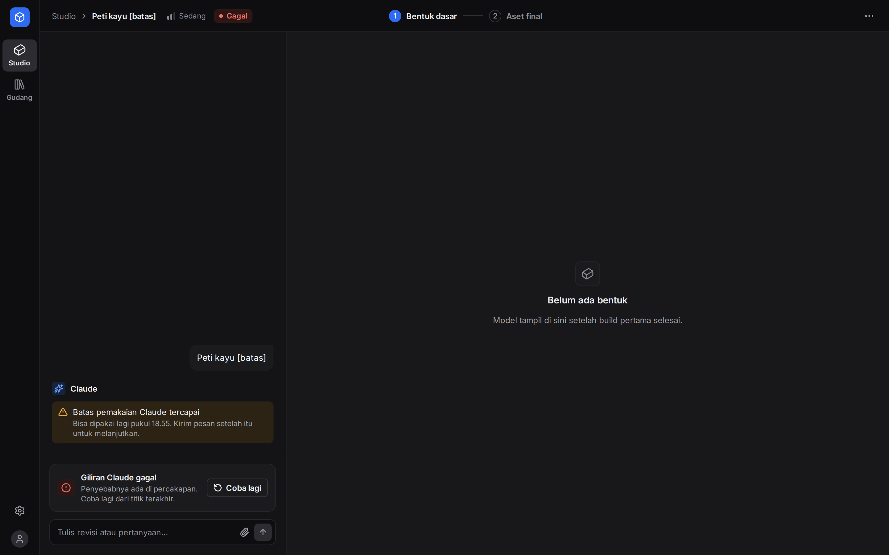
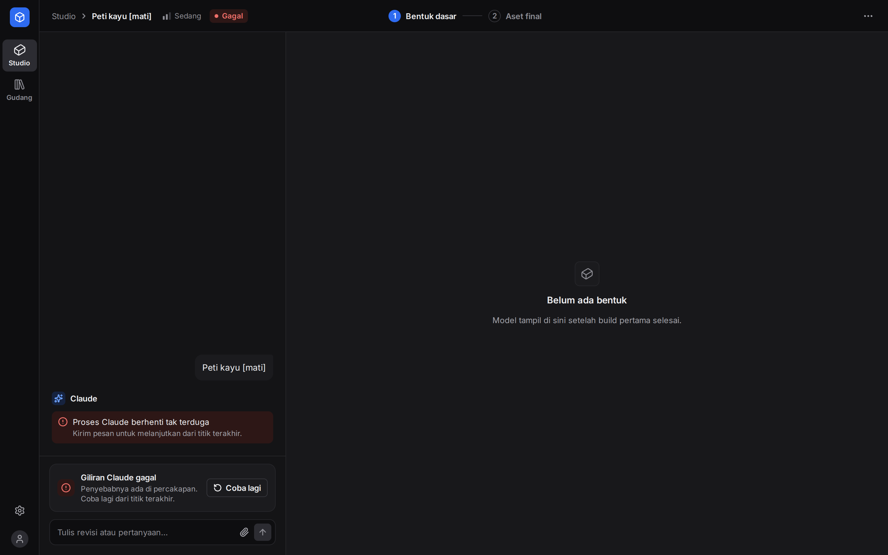
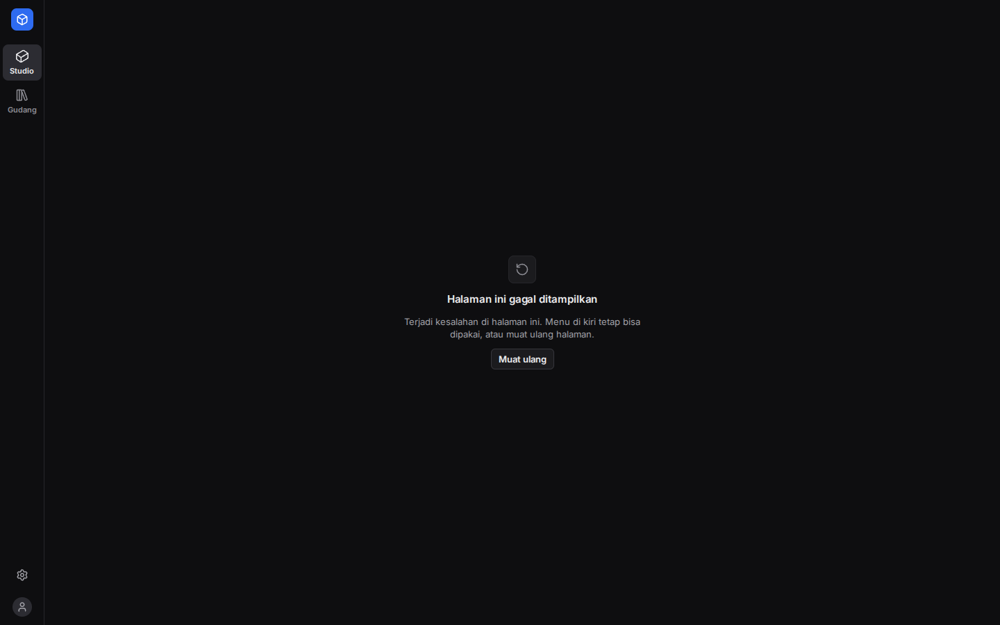
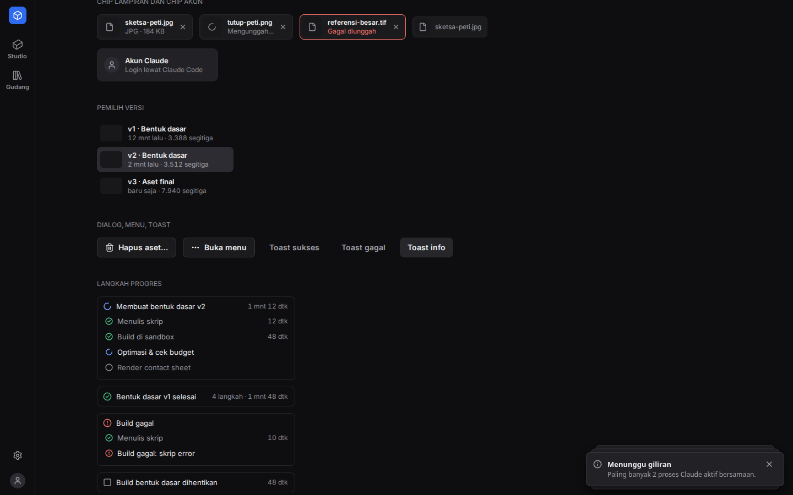

# Status dan masalah

Halaman ini menjelaskan semua banner, blok error, kartu pemulihan, toast, dan notifikasi yang bisa muncul.

Langkah perbaikan di sisi mesin (login, Docker, port, systemd) ada di
[tabel pemecahan masalah README](../../README.md#pemecahan-masalah).

## Banner status

Banner tampil di bawah topbar Studio, sesi Studio, Gudang, dan Detail aset (tidak di Pengaturan, yang sudah
menampilkan rinciannya). Bila akun dan runtime sama-sama bermasalah, banner akun di atas. Banner hilang sendiri setelah
masalahnya selesai.

### Akun Claude

| Banner | Penyebab | Aksi |
|---|---|---|
| "Claude Code belum login. Jalankan claude di terminal mesin ini, lalu ketik /login." | Belum login atau sesi kedaluwarsa | **Periksa ulang** |
| "Claude Code memakai API key. App ini hanya memakai sesi login langganan: hapus ANTHROPIC_API_KEY, lalu periksa ulang." | Ada sumber API key | **Periksa ulang** |
| "Claude Code tidak bisa dijalankan. Pastikan claude terpasang dan ada di PATH." | Proses `claude` gagal dijalankan | **Periksa ulang** |

### Runtime 3D

| Banner | Penyebab | Aksi |
|---|---|---|
| "Runtime 3D belum siap: image belum dibangun. Aset belum bisa dibuat atau direvisi." | Image Docker `asset-forge` belum ada | **Bangun image** |
| "Membangun image runtime… Biasanya beberapa menit. Gudang tetap bisa dibuka." | Build image berjalan | Tunggu |
| "Docker tidak terjangkau. Jalankan Docker, lalu periksa ulang." | Docker mati atau tidak bisa diakses | **Periksa ulang** |
| "Gagal membangun image runtime. Detailnya ada di Pengaturan." | Build image terakhir gagal | **Buka Pengaturan** (lihat **Akhir log build**) |

### Sambungan realtime

Di sesi Studio, bila sambungan ke server putus: "Koneksi ke server terputus. Menyambung ulang…" dengan tombol
**Sambungkan sekarang**. Event yang tertinggal diputar ulang setelah tersambung lagi.

## Blok error di thread

| Blok | Arti | Lanjutkan dengan |
|---|---|---|
| **Claude Code belum login atau sesinya kedaluwarsa** | Sesi login habis di tengah giliran | Jalankan `claude`, ketik `/login`, lalu kirim pesan |
| **Batas pemakaian Claude tercapai** | Kuota langganan habis. "Bisa dipakai lagi pukul jam" bila waktu reset diketahui | Kirim pesan (atau **Coba lagi**) setelah waktu itu |
| **Claude mencoba aksi yang tidak diizinkan** | Aksi Claude ditolak pagar keamanan | Kirim pesan |
| **Proses Claude berhenti tak terduga** | Giliran gagal karena sebab lain | Kirim pesan untuk melanjutkan dari titik terakhir |

Badge aset menjadi **Gagal** selama giliran gagal belum dilanjutkan.

## Kartu pemulihan di dock

| Kartu | Kapan | Tombol |
|---|---|---|
| **Giliran Claude gagal** — "Penyebabnya ada di percakapan. Coba lagi dari titik terakhir." | Giliran gagal saat tahap masih dikerjakan | **Coba lagi** |
| **Proses Claude terputus** — "Server sempat berhenti. Lanjutkan dari titik terakhir." | Server berhenti (restart, crash) di tengah giliran | **Lanjutkan** |

Bila giliran gagal setelah versi sudah diserahkan untuk review, kartu review tetap tampil dan **Setujui** atau
**Selesai** tetap bisa dipakai.

## Halaman error

| Tampilan | Kapan | Aksi |
|---|---|---|
| **Halaman ini gagal ditampilkan** | Satu halaman error saat dirender; rel kiri tetap bisa dipakai | **Muat ulang** |
| **Halaman gagal dimuat** | Kerangka app sendiri gagal | **Muat ulang** |
| **Halaman tidak ditemukan** | Alamat tidak ada | **Kembali ke Studio** |
| **Aset tidak ditemukan** / **Aset sudah dihapus** | Aset tidak ada, atau dihapus dari tab lain | **Kembali ke Studio** / **Kembali ke Gudang** |
| **Aset gagal dimuat**, **Daftar aset gagal dimuat**, **Pengaturan gagal dimuat** | Server tidak bisa dihubungi saat pemuatan pertama | **Coba lagi** |

Bila data yang sudah tampil gagal diperbarui, halaman tetap menampilkan data terakhir dan hanya memberi toast
(mis. "Data aset gagal diperbarui").

## Toast

| Toast | Kapan |
|---|---|
| "Nama siap direview", "Nama selesai", "Nama gagal", "Nama butuh jawaban Anda" | Aset **lain** (bukan yang sedang dibuka) berubah status. Toast baru untuk aset yang sama menggantikan yang lama, dan hilang saat aset itu dibuka |
| Hasil aksi, mis. "Salinan dibuat: …", "Nama dihapus", "Pengaturan disimpan" | Aksi berhasil |
| Gagal aksi, mis. "Aset gagal dibuat", "Pesan gagal dikirim", "Aksi gagal", "Ekspor gagal", "ZIP gagal dibuat" | Aksi ditolak server; pesannya menyebut sebabnya |
| Lampiran ditolak, mis. "Maksimal 8 lampiran per pesan." | Jenis, ukuran, atau jumlah lampiran tidak sesuai |
| **Terjadi kesalahan tak terduga** | Error yang lolos dari semua penanganan. "Aksi terakhir mungkin tidak selesai. Bila tampilan terlihat aneh, muat ulang halaman." |

## Toast dan notifikasi browser

Notifikasi browser memakai judul yang sama dengan toast status di atas ("… siap direview", "… selesai", "… gagal",
"… butuh jawaban Anda") dan isi "Buka AI Asset Generate untuk melihatnya.". Notifikasi hanya muncul bila:

- izin sudah diberikan lewat **Izinkan notifikasi** di [Pengaturan](06-pengaturan.md), dan
- tab app sedang tidak dilihat (juga untuk aset yang sedang dibuka di tab itu).

Klik notifikasi membuka sesi aset tersebut.

## Lihat juga
- [Pengaturan](06-pengaturan.md)
- [Studio](02-studio.md)
- [README: pemecahan masalah](../../README.md#pemecahan-masalah)
- [Claude Agent](../teknis/02-claude-agent.md)
- [Keamanan](../teknis/06-keamanan.md)
