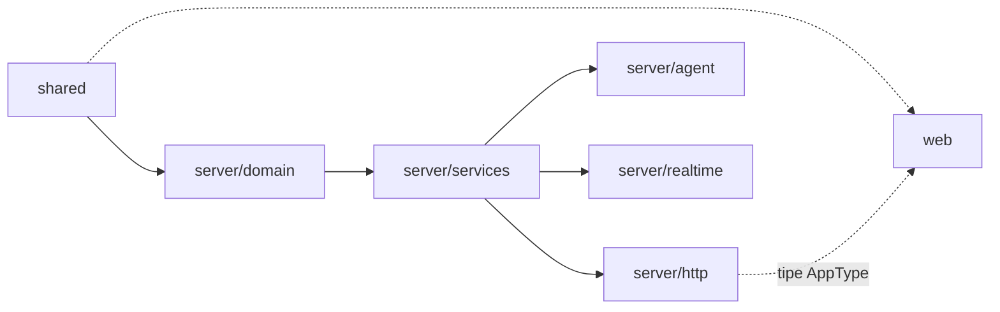
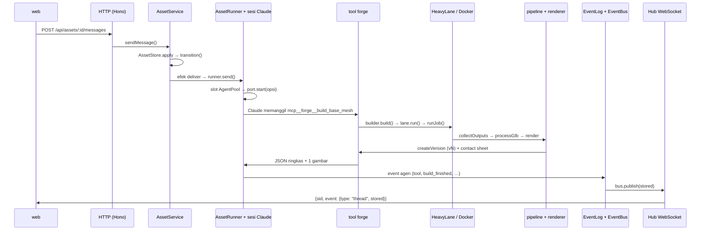

# Arsitektur

Peta sistem AI Asset Generate: lapisan kode, satu pintu per integrasi, cara server dirakit, dan perjalanan satu
giliran dari browser sampai versi aset baru.

## Gambaran sistem
App ini satu proses Bun yang hanya bind `127.0.0.1` (`server/config.ts`, `host: "127.0.0.1"` tidak bisa diubah lewat
env). Proses itu melayani API Hono, WebSocket `/api/ws`, dan (di mode production/test) hasil build web.

Di luar proses Bun ada tiga proses pembantu:

| Proses | Dijalankan oleh | Untuk |
|---|---|---|
| Claude Code (CLI `claude`) | Agent SDK lewat `server/agent/sdk-adapter.ts` | Sesi Claude per aset, memakai sesi login (tanpa API key) |
| Container `asset-forge` | `server/runtime/docker.ts` | Skrip Blender (`bpy`) headless di sandbox |
| Chromium headless | `server/render/renderer.ts` (Playwright) | Contact sheet untuk Claude, thumbnail dan turntable Gudang |

Pilihan library dan alasannya ada di [TECH_STACK](../TECH_STACK.md); rencana per tahap di [PLAN](../PLAN.md).

## Lapisan dan arah dependensi
Aturannya ada di [AGENTS.md](../../AGENTS.md) §3 dan dijaga tes `tests/architecture/boundaries.test.ts`.

Panah berarti "dipakai oleh". Penjelasannya:

1. `shared/` berisi skema zod, tipe event, dan angka batas (`shared/limits.ts`). Dipakai server dan web.
2. `server/domain/` murni, tanpa I/O: `status.ts` (mesin status `transition()`), `shape.ts` (cek bentuk),
   `answers.ts` (validasi jawaban kartu pertanyaan).
3. `server/services/` memegang I/O aset: database lewat repositori, file versi, event bus, ekspor, thumbnail.
   `AssetService` tidak meng-import `server/agent`; sesi Claude dibuat lewat fungsi `createAgent` yang disuntikkan.
4. `server/http`, `server/agent`, dan `server/realtime` berada di atas service.
5. `web/` hanya bergantung pada `shared/` dan tipe `AppType` dari `server/app.ts` (client `hc` Hono).

## Satu pintu per integrasi
Setiap integrasi luar hanya disentuh dari satu tempat. Kode lain memakai antarmuka kecil.

| Integrasi | Satu-satunya tempat | Antarmuka untuk kode lain |
|---|---|---|
| Agent SDK (`query`) | `server/agent/sdk-adapter.ts` | `AgentPort` / `AgentSession` (`server/agent/port.ts`) |
| Opsi sesi Claude | `server/agent/options.ts` | `buildSessionOptions()`, `buildProbeOptions()` |
| Docker CLI | `server/runtime/docker.ts` | `runJob()`, `buildImage()`, `removeOrphanJobs()` |
| Chromium renderer | `server/render/` | `Renderer.render()`, `Renderer.turntable()` |
| Database | `server/db/repos/` | fungsi repositori (`appendEvent`, `insertVersion`, …) |
| Status aset | `server/domain/status.ts` | `transition()` lewat `AssetStore.apply` |
| Angka batas | `shared/limits.ts` | konstanta bernama |

Penjelasan tiap integrasi: [Claude](02-claude-agent.md), [runtime 3D](03-runtime-3d.md), [data](05-data.md).

## Komposisi server
`server/compose.ts` (`createServices`) adalah akar komposisi dan satu-satunya tempat yang memilih driver:

| Env | Nilai | Hasil |
|---|---|---|
| `AGENT_DRIVER` | `sdk` (bawaan) | `sdkAgentPort` — Claude sungguhan, memakai kuota pemilik |
| | `fake` | `ScenarioAgentPort` + `defaultScenario` — deterministik, tanpa kuota |
| `RUNTIME_DRIVER` | `docker` (bawaan) | `DockerAssetBuilder` + `Renderer` (Chromium diluncurkan saat render pertama) |
| | `fixture` | `FixtureAssetBuilder` — GLB dan contact sheet siap pakai, tanpa Docker dan Chromium |

`createServices` merakit `EventBus`, `AgentPool`, `HeavyLane`, `MaterialLibrary`, `ThumbnailService`,
`ExportService`, `AccountProbe`, `SettingsService`, `RuntimeStatusService`, `AssetService`, `AssetQueries`, dan
`Hub`. Env lain (`PORT`, `DATA_DIR`, `DIST_DIR`, `LOG_LEVEL`, `NODE_ENV`) dibaca `loadConfig()` di
`server/config.ts` dan divalidasi zod.

### Urutan start (`server/main.ts`)
1. `loadConfig()` dan logger pino.
2. `openDatabase()` (`server/db/client.ts`): PRAGMA, lalu migrasi Drizzle yang belum diterapkan.
3. `createServices()`. Di dalamnya `assets.recover()` berjalan **sebelum** server menerima request: job yang belum
   selesai dibatalkan, kartu pertanyaan terbuka ditutup, dan aset `running`/`waiting_user` menjadi `interrupted`.
   Setelah itu hub WebSocket mulai berdetak.
4. `createApp()` (`server/app.ts`): pagar Host/Origin, error handler, rute `/api`, dan (bila ada build) file web.
5. `Bun.serve()` dengan `idleTimeout: HTTP_IDLE_TIMEOUT_S`, `maxRequestBodySize` sedikit di atas
   `UPLOAD_MAX_REQUEST_BYTES`, `maxPayloadLength: WS_MAX_PAYLOAD_BYTES`, dan handler `drain` ke `hub.drain()`.
6. Khusus `RUNTIME_DRIVER=docker`: `removeOrphanJobs()` di latar menghapus container job yatim milik `DATA_DIR` ini
   (label `aag.owner`). Docker yang mati tidak menghentikan server.
7. `Maintenance.start()`: backup harian dan pembersihan, sekali saat start lalu tiap `MAINTENANCE_INTERVAL_MS`
   (lihat [Data](05-data.md#pemeliharaan-dan-backup)).

### Urutan berhenti
Pada `SIGINT`/`SIGTERM`, `shutdown()` menjalankan: `maintenance.stop()` → `hub.stop()` (WebSocket ditutup dulu,
karena `server.stop()` menunggu sambungan terbuka) → `server.stop()` → `services.close()` (sesi Claude ditutup, build
dibatalkan, Chromium ditutup) → `database.close()`.

## Alur satu giliran
Contoh: pemilik mengirim pesan revisi, Claude membangun ulang bentuk dasar.

1. Web mengirim multipart `text` + `files[]`. Rute di `server/http/routes/assets.ts` memvalidasi bentuknya dengan zod.
2. `AssetService.sendMessage()` (`server/services/assets.ts`) menyimpan lampiran ke `refs/`, lalu memanggil
   `AssetStore.apply()`. `transition()` memutuskan status baru dan efek `deliver`, dan bisa menolak (mis.
   `QUESTION_OPEN`). Status + event `state` disimpan dalam satu transaksi.
3. Efek `deliver` sampai ke `AssetSession.deliver()` (`server/agent/asset-session.ts`), yang menyusun teks lewat
   `server/agent/prompts.ts` dan memanggil `AssetRunner.send()`.
4. Runner meminta slot ke `AgentPool` (maks. `AGENT_POOL_SIZE` proses), memulai proses lewat `AgentPort` bila
   belum hidup, dan mengirim pesan dengan uuid sendiri.
5. Claude menulis `work/base.py` (Write/Edit dijaga pagar), lalu memanggil `build_base_mesh`. `Forge`
   (`server/agent/forge/server.ts`) mengecek gerbang lewat `transition()` dan memakai satu jatah build.
6. `DockerAssetBuilder` menjalankan `buildBaseVersion()` (`server/services/build-version.ts`) di `HeavyLane`
   (satu job berat sekaligus): folder job → `runJob()` → output dibaca dengan `collectOutputs()`.
7. `processGlb()` (`server/pipeline/process.ts`) mengoptimasi, memvalidasi, mengompresi `web.glb`, dan menghitung
   budget. `Renderer.render()` membuat contact sheet.
8. `createVersion()` menulis `versions/vN` secara atomik dan read-only; contact sheet ke `derived/vN/`.
   `Forge` mencatat versi (`recordVersion`) dan menerapkan `build_done`.
9. Hasil tool ke Claude: JSON ringkas + satu PNG contact sheet.
10. Semua event agen masuk `AssetService`, dicatat `EventLog` (tabel `events`, kecuali event live), lalu disiarkan
    `EventBus`. `build_finished` yang sukses memicu `ThumbnailService.ensure()` di latar.
11. `Hub` (`server/realtime/hub.ts`) meneruskan event ke pelanggan topik `asset:<id>`; progres build juga ke topik
    `global`. Web menginvalidasi atau me-merge cache TanStack Query.

Giliran selesai saat runner menerima `result` yang mencocokkan uuid pesan (`user_message_uuids`); `transition()`
menerima `turn_ended`. Bila Claude memanggil `submit_for_review`, status pindah ke `*_REVIEW`.

## Struktur folder repo

| Folder | Isi |
|---|---|
| `server/agent/` | Sesi Claude: port, adapter SDK, opsi, pagar, runner, pool, tool `forge`, prompt, driver palsu |
| `server/db/` | Klien SQLite, skema Drizzle, `migrations/`, `repos/` |
| `server/domain/` | Logika murni: status, cek bentuk, jawaban |
| `server/http/` | Pagar Host/Origin, error, validasi, respons file, `routes/` |
| `server/jobs/` | `HeavyLane` (antrean job berat) dan `Semaphore` |
| `server/library/` | Katalog pustaka material CC0 |
| `server/pipeline/` | Optimasi, validasi, statistik glTF, preset Unity |
| `server/realtime/` | Hub WebSocket dan rute upgrade |
| `server/render/` | Renderer Chromium, halaman render (`page/`), contact sheet, turntable |
| `server/runtime/` | Docker, tag image, folder job, pembaca output |
| `server/services/` | Aset, kueri, versi, ekspor, thumbnail, pengaturan, status runtime, pemeliharaan |
| `shared/` | Skema zod, tipe event, batas, port, format |
| `web/` | React: `app/` (router, shell), `components/`, `features/`, `lib/`, `i18n/`, `styles/` |
| `runtime/` | Dockerfile, `assetkit/`, `knowledge/`, `tests/` (pytest), `samples/`, `probes/`, daftar material |
| `scripts/` | Dev, doctor, runtime, eval, sinkron token/tekstur, fixture |
| `tests/` | `architecture/`, `e2e/`, `e2e-api/`, `integration/`, `pipeline/`, `smoke/`, `fixtures/`, `goldens/` |
| `design/` | File FigCraft, ekspor PNG, token, alat render desain |
| `deploy/` | Unit systemd |
| `eval/` | Hasil `eval:*` (di-gitignore) |
| `data/` | Data pemilik (di-gitignore); lihat [Data](05-data.md#folder-data) |

## Lihat juga
- [Claude Agent](02-claude-agent.md)
- [Runtime 3D](03-runtime-3d.md)
- [API](04-api.md)
- [Data](05-data.md)
- [Keamanan](06-keamanan.md)
- [Frontend](07-frontend.md)
- [Tes](08-tes.md)
- [Menambah fitur](09-menambah-fitur.md)
- [Ikhtisar fitur](../fitur/01-ikhtisar.md)
- [PLAN](../PLAN.md), [TECH_STACK](../TECH_STACK.md), [AGENTS.md](../../AGENTS.md), [README](../../README.md)
