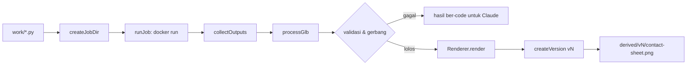

# Runtime 3D

Bagaimana skrip Blender tulisan Claude menjadi versi aset: image `asset-forge`, sandbox Docker, `assetkit`,
pipeline glTF, renderer Chromium, dan penyimpanan versi.

## Ringkasan alur build
`buildBaseVersion()` dan `buildTexturedVersion()` (`server/services/build-version.ts`) menjalankan satu build di
dalam `HeavyLane` (`server/jobs/heavy-lane.ts`). Lane ini menjalankan job berat satu per satu (antrean FIFO), bisa
dibatalkan lewat `AbortSignal`, dan baru melepas slot setelah container benar-benar berhenti.

1. Skrip disalin ke folder job sementara sebagai `script.py`. Build bertekstur juga menyalin skrip bentuk dasar yang
   disetujui sebagai `base.py`.
2. `runJob()` menjalankan container dengan flag sandbox. Progres container (60% pertama) diteruskan ke lane.
3. Output dibaca tanpa mempercayai container.
4. Pipeline mengoptimasi, memvalidasi, dan mengompresi.
5. Build bertekstur dicek bentuknya terhadap bentuk dasar yang disetujui (`SHAPE_DRIFT`).
6. Contact sheet dirender, versi ditulis write-once, dan folder job dihapus (`removeJobDir`).

Kegagalan skrip dikembalikan sebagai hasil ber-`code` (`SCRIPT_ERROR`, `TIMEOUT`, `OOM`, `VALIDATION_FAILED`,
`SHAPE_DRIFT`), bukan dilempar. Pesan `SCRIPT_ERROR` membawa ekor stderr (maks. 2000 karakter) supaya Claude bisa
membaca traceback.

## Image `asset-forge`
- **Dockerfile:** `runtime/Dockerfile`. Basis `python:3.13-slim` (di-pin digest), library sistem minimal untuk
  `bpy`, lalu `pip install -r runtime/requirements.txt` (`bpy`, `xatlas`, `numpy`, `pytest`, versi exact). User
  non-root `10001` sebagai cadangan.
- **Tag:** `runtimeImageTag()` (`server/runtime/image.ts`) = `asset-forge:` + 12 hex sha256 isi `Dockerfile` dan
  `requirements.txt`. Mengubah salah satunya menghasilkan tag baru.
- **`assetkit` tidak dipanggang** ke image. Paket itu dipasang read-only di `/opt/assetkit` saat job berjalan, jadi
  mengubah helper tidak perlu build ulang image.
- **Membangun:** `bun run runtime:build`, atau tombol "Bangun image" di Pengaturan (`POST /api/health/runtime/image`,
  `RuntimeStatusService`). Batas waktunya `IMAGE_BUILD_TIMEOUT_MS` (`shared/limits.ts`).
- Versi Blender yang dilaporkan = versi `bpy` di `requirements.txt` (`blenderVersion()`).

## Sandbox `docker run`
`buildRunArgs()` di `server/runtime/docker.ts` adalah fungsi murni, dijaga tes snapshot
(`server/runtime/__snapshots__/docker.test.ts.snap`). Mengubah flag berarti memperbarui snapshot dan mencatat
alasannya di Log keputusan ([PLAN](../PLAN.md)).

| Flag | Alasan |
|---|---|
| `--name aag-job-<jobId>` | Nama tetap untuk `docker kill`/`inspect` |
| `--label aag.job=<jobId>`, `--label aag.owner=<owner>` | Pembersihan container yatim per `DATA_DIR` (`ownerForDataDir`) |
| `--init` | Proses anak di-reap dan sinyal diteruskan |
| `--pull never` | Image hanya dari build lokal; tidak pernah ditarik dari registry |
| `--network none` | Skrip tidak punya akses jaringan |
| `--read-only` + `--tmpfs /tmp:rw,nosuid,nodev,size=…` | FS read-only kecuali `/tmp` dan `/job` |
| `--cap-drop ALL`, `--security-opt no-new-privileges` | Tanpa capability, tanpa eskalasi |
| `--pids-limit` | Melawan fork bomb |
| `--memory` = `--memory-swap` | Batas RAM tanpa swap tambahan |
| `--cpus` | Batas CPU; juga `AAG_THREADS` untuk Cycles |
| `--user <uid:gid>` | File di `/job` milik pemilik `data/` |
| `--env HOME=/tmp`, `AAG_THREADS`, `AAG_JOB_ID`, `PYTHONPATH=/opt/assetkit`, `PYTHONDONTWRITEBYTECODE=1`, `AAG_MATERIALS` (bertekstur) | Lingkungan job |
| `--mount` `/job` (rw), `/refs` (ro), `/opt/assetkit` (ro), `/materials` (ro, bertekstur) | Hanya folder yang perlu |

Path mount ditolak bila tidak absolut atau memuat koma/baris baru (koma bisa menyelipkan opsi `--mount`). Semua
perintah `docker` dijalankan lewat `Bun.spawn` dengan array argumen, tanpa shell.

`runJob()` tidak memakai `--rm`: setelah container keluar, `docker inspect` membaca `OOMKilled` dan kode keluar, lalu
container dihapus. Timeout dan pembatalan memanggil `docker kill` (diulang bila container belum sempat dibuat).
`removeOrphanJobs(owner)` dipanggil saat server start.

`bun run test:assetkit` menjalankan pytest `runtime/tests/` di dalam image dengan flag sandbox yang sama.

## Batas per job
Semua angka di `shared/limits.ts` (`JobLimits`).

| Job | Konstanta | Nilai sekarang (contoh) |
|---|---|---|
| Bentuk dasar | `BASE_JOB_LIMITS` | 1,5 GiB RAM, 4 CPU, 256 pids, tmpfs 512 MiB, 120 dtk |
| Bertekstur | `TEXTURED_JOB_LIMITS` | 2,5 GiB RAM, 300 dtk |
| Bertekstur berat | `TEXTURED_MAX_JOB_LIMITS` | 600 dtk; dipilih `texturedJobLimits()` bila atlas ≥ 2048 px atau segitiga maks > Sedang bawaan |
| pytest `assetkit` | `TEST_JOB_LIMITS` | 300 dtk |

Ukuran output yang diterima: `BASE_OUTPUT_MAX_BYTES` dan `TEXTURED_OUTPUT_MAX_BYTES` (`base.glb`/`final.glb`,
`stats.json`, `scene.blend`).

## Folder job dan perintah
`server/runtime/job-dir.ts`:
- `createJobDir()` membuat `data/jobs/job-XXXX/` berisi `script.py`, file tambahan (`base.py`), dan `out/`.
- `removeJobDir()` hanya mau menghapus folder `job-*` di bawah root jobs.
- `BASE_JOB_COMMAND`: `python -m assetkit.run /job/script.py --export out/base.glb --stats out/stats.json --blend out/scene.blend`.
- `texturedJobCommand(sizes)`: menambah `--textured --base-color N [--normal N] [--orm N] --library-res 1k|2k` dan
  mengekspor `out/final.glb`. Ukuran atlas dari `bakeSizes(tier)`, jadi skrip Claude tidak memilih resolusi.

Ekspor GLB dan statistik adalah **tugas harness** (`assetkit.run`), bukan skrip Claude. Bentuk dasar selalu
diekspor tanpa material.

### Protokol stdout
`assetkit` mencetak baris `@@aag {json}` (`runtime/assetkit/assetkit/protocol.py`). `parseProtocolLine()` hanya
menerima `progress` (`step`, `pct`) dan `memory` (`peakBytes`) yang lolos zod; baris lebih dari 4096 karakter
diabaikan. Ekor stdout/stderr dibatasi `JOB_OUTPUT_TAIL_BYTES`.

## Output container tidak dipercaya
`collectOutputs()` (`server/runtime/outputs.ts`) membaca `out/` dengan `lstat`:

| Kondisi | Hasil |
|---|---|
| Symlink | ditolak (`symlink`), tidak diikuti |
| Bukan file biasa | ditolak (`not_file`) |
| Nama tidak di-allowlist | ditolak (`not_allowed`) |
| Hardlink (`nlink > 1`) | ditolak (`hardlink`) |
| Lebih besar dari batas | ditolak (`too_large`) |

## `assetkit`
Paket Python di `runtime/assetkit/assetkit/`, lapisan stabil di atas `bpy` untuk skrip Claude. Memakai data API atau
`temp_override`, bukan operator yang butuh UI. Setiap helper punya pytest di `runtime/tests/`.

| Modul | Isi |
|---|---|
| `scene` | Scene kosong dengan konvensi assetkit (`reset`, `run_base` untuk tahap tekstur) |
| `prim` | Primitif mesh dengan bmesh (meter; posisi = pusat) |
| `mod` | Modifier non-destruktif, diterapkan oleh `finalize()` |
| `material` | Material PBR tahap tekstur, termasuk dari pustaka |
| `uv` | Layer UV, `unwrap` dengan xatlas |
| `bake` | Bake Cycles CPU (atlas, normal/AO dari high-poly) |
| `decal` | Gambar dari `/refs` atau bentuk cat yang diproyeksikan |
| `finalize`, `io`, `stats` | Tugas harness: finalisasi mesh, ekspor GLB/`.blend`, statistik |
| `protocol`, `run` | Protokol stdout dan wrapper job |

Referensi untuk Claude ada di `runtime/knowledge/` (lihat [Claude Agent](02-claude-agent.md#prompt-dan-knowledge)).
Skrip contoh di `runtime/samples/` dipakai `bun run runtime:samples` untuk membuat fixture GLB.

## Pipeline glTF
`processGlb()` (`server/pipeline/process.ts`), memakai gltf-transform lewat satu `NodeIO` (`server/pipeline/io.ts`).

1. **Optimasi** (`optimizeDocument()`, `server/pipeline/optimize.ts`): `dedup` → `palette` (hanya Ringan dengan
   lebih dari satu material) → `flatten` + `join` + `weld` → `simplify` (hanya bentuk dasar, bila segitiga lewat
   maks tetapi ≤ maks × `SIMPLIFY_MAX_OVERSHOOT`) → buang tekstur di slot yang tidak diizinkan tier → `prune` →
   resize tekstur per slot sesuai tier.
2. **Statistik** (`documentStats()`, `server/pipeline/stats.ts`): segitiga dan vertex per instance node, material,
   tekstur per slot, bbox.
3. **Validasi** (`validateGlb()`, `server/pipeline/validate.ts`) dengan gltf-validator, **sebelum** kompresi, karena
   validator tidak bisa membaca `EXT_meshopt_compression`. Laporannya divalidasi zod. Error > 0 → tidak ada
   `web.glb`, build gagal `VALIDATION_FAILED`.
4. **Kompresi Web** (`compressForWeb()`): tekstur ke WebP lalu meshopt. Hasilnya `web.glb`.
5. **Budget** (`checkBudget()` di `shared/limits.ts`): segitiga, material, sisi tekstur per slot, dan (hanya aset
   final) ukuran `web.glb`. `ok` = tidak ada item `over_max`.

Budget memakai `tierSnapshot` milik aset, bukan Pengaturan saat ini. Angka bawaan tier ada di `DEFAULT_TIERS`;
penjelasan untuk pemilik di [Tier dan budget](../fitur/07-tier-dan-budget.md).

**Cek bentuk** (`checkShape()`, `server/domain/shape.ts`, toleransi `SHAPE_TOLERANCE`): bbox dan jumlah segitiga
aset final dibandingkan dengan bentuk dasar yang disetujui.

**Unity** (`toUnityGlb()`, `server/pipeline/unity.ts`): dari GLB versi yang belum dikompresi, ekstensi di
`UNITY_BLOCKED_EXTENSIONS` dibuka (meshopt, Draco, kuantisasi, KTX2, WebP/AVIF), tekstur diubah ke PNG, lalu
divalidasi ulang dan wajib 0 error. Dipakai `ExportService` saat ekspor Unity.

## Renderer Chromium
`Renderer` (`server/render/renderer.ts`) adalah satu-satunya pintu ke Chromium (Playwright).

- Satu browser hidup lama dan satu halaman yang dipakai ulang; render dijalankan satu per satu (`Semaphore`).
- Chromium memakai SwiftShader (`--use-angle=swiftshader`) supaya hasil deterministik.
- Halaman (`server/render/page/main.ts`, three.js) tidak punya akses jaringan: semua request dilayani `page.route`
  dari memori di origin `http://aag-render.invalid`.
- Hasil halaman divalidasi zod (`server/render/protocol.ts`), karena berasal dari proses lain.
- GLB di atas `RENDER_MAX_GLB_BYTES` ditolak (`MODEL_TOO_LARGE`). Error lain: `RENDER_TIMEOUT`, `RENDER_CANCELLED`,
  `RENDER_FAILED`.

| Keluaran | Detail |
|---|---|
| Contact sheet (`render()`) | Mode `clay`/`wireframe`/`texture`; sudut `RENDER_VIEWS` (depan, belakang, kiri, kanan, atas, 3/4); tile `RENDER_TILE_PX`, grid maks. 3 kolom (`composeContactSheet`), sisi ≤ `CONTACT_SHEET_MAX_PX`; batas `RENDER_TIMEOUT_MS` |
| Turntable (`turntable()`) | `TURNTABLE_FRAMES` frame berukuran `TURNTABLE_FRAME_PX`, disusun `composeTurntable()` menjadi `thumb.webp` (frame pertama) dan `turntable.webp` (strip ≤ `WEBP_MAX_SIDE_PX`); batas `TURNTABLE_TIMEOUT_MS` |

**Kebijakan restart:** browser atau halaman yang crash dibuat ulang otomatis dan render dicoba ulang sekali. Browser
diluncurkan ulang setelah `RENDER_RECYCLE_AFTER` render dan ditutup setelah menganggur `RENDER_IDLE_CLOSE_MS`.
Semua objek per render wajib di-dispose; tes pipeline menjaganya lewat `Renderer.gpuMemory()`.

## Versi write-once
`createVersion()` (`server/services/versions.ts`):

1. Semua file ditulis ke `versions/.staging-*`.
2. Setiap file dibuat read-only (0444), dan `manifest.json` mencatat `version`, `createdAt`, `files` (nama, byte,
   sha256), dan `meta`.
3. Staging di-rename atomik menjadi `versions/vN`, lalu foldernya dibuat read-only (0555). Bila nomor versi direbut,
   rename dicoba ulang.

Isi folder versi:

| Tahap | File |
|---|---|
| Bentuk dasar | `base.glb`, `web.glb`, `script.py`, `stats.json`, `scene.blend` (bila ada), `manifest.json` |
| Aset final | `final.glb`, `web.glb`, `script.py` (`material.py`), `base.py`, `stats.json`, `scene.blend` (bila ada), `manifest.json` |

`meta` manifest memuat `stage`, `tierId`, `jobId`, `peakMemBytes`, `timings`, ringkasan validator dan optimasi, dan
`baseVersion` untuk aset final. Setelah versi terbentuk, isinya tidak pernah diubah.

**Hasil turunan** ditulis `writeDerived()` ke `derived/vN/`, tidak pernah ke `versions/`:

| File | Dibuat oleh |
|---|---|
| `contact-sheet.png` | Build (render terakhir) |
| `thumb.webp`, `turntable.webp` | `ThumbnailService` (`server/services/thumbnails.ts`) |
| `export-unity.glb` | `ExportService`, saat ekspor Unity pertama |
| `export-source-<hash>.zip` | `ExportService`, saat ekspor Sumber (hash dari nama aset) |

## Thumbnail
`ThumbnailService` membuat `thumb.webp` + `turntable.webp` dari `web.glb` (render `clay` untuk bentuk dasar,
`texture` untuk aset final), selalu di luar request:
- setelah build sukses (`ensure()`, dipicu `onVersionCreated`);
- untuk versi yang belum punya, saat daftar/detail memintanya (`schedule()`): antre di latar, satu render sekaligus.

Setelah selesai, topik `global` menerima event `asset` `updated`. Dengan `RUNTIME_DRIVER=fixture` (tanpa renderer)
hanya file yang sudah ada yang tersedia.

## Pustaka material CC0
- **Daftar:** `runtime/materials.txt` (id ambientCG + kategori). Checksum ZIP: `runtime/materials.lock.json`
  (dicatat saat unduhan pertama, karena API ambientCG tidak memberi checksum).
- **Unduh:** `bun run textures:sync` (`scripts/textures-sync.ts`, butuh jaringan). Host unduhan di-allowlist di
  `scripts/textures/library.ts`. Hasil: `data/library/materials/<id>/{1k,2k}/<map>.jpg`, `preview.jpg`, dan
  `catalog.json`.
- **Pakai:** `MaterialLibrary` (`server/library/materials.ts`) membaca katalog (dibaca ulang bila berubah), mencari
  (`searchCatalog`, maks. `MAX_RESULTS`), dan membuat lembar contoh untuk `list_materials`. Di container, pustaka
  dipasang read-only di `/materials`.
- Tanpa katalog, `build_textured_asset` dan `list_materials` gagal `LIBRARY_MISSING`.

## Lihat juga
- [Arsitektur](01-arsitektur.md)
- [Claude Agent](02-claude-agent.md)
- [Data](05-data.md#folder-data)
- [Keamanan](06-keamanan.md)
- [Tes](08-tes.md)
- [Ekspor](../fitur/05-ekspor.md), [Tier dan budget](../fitur/07-tier-dan-budget.md)
- [AGENTS.md](../../AGENTS.md) §7, [PLAN](../PLAN.md) Lampiran E dan G
