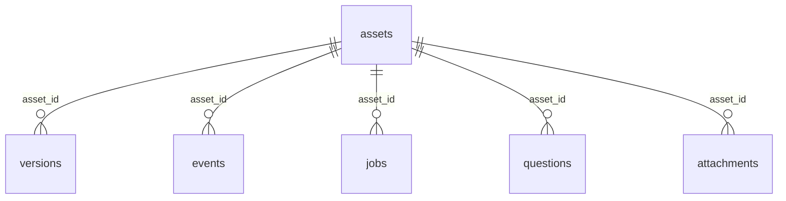
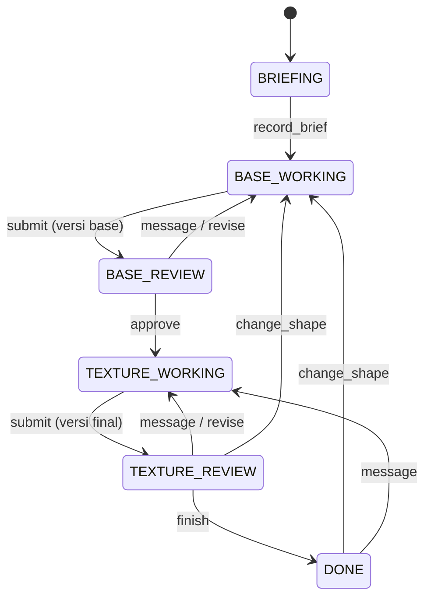

# Data

Skema SQLite, repositori, migrasi, mesin status aset, event store, folder `data/`, serta pemeliharaan dan backup.

## Database
`data/app.db` (path dari `DATA_DIR`, lihat `server/config.ts`), dibuka `openDatabase()` di `server/db/client.ts`
dengan `bun:sqlite` + Drizzle.

PRAGMA yang selalu dinyalakan saat membuka:

| PRAGMA | Nilai | Alasan |
|---|---|---|
| `journal_mode` | `WAL` | Pembaca tidak menahan penulis; backup aman selama berjalan |
| `synchronous` | `NORMAL` | Aman untuk WAL, lebih cepat dari `FULL` |
| `foreign_keys` | `ON` | `ON DELETE CASCADE` dari tabel anak ke `assets` berlaku |
| `busy_timeout` | `SQLITE_BUSY_TIMEOUT_MS` (`shared/limits.ts`, sekarang 5000 ms) | Menunggu kunci tulis sebelum menyerah |

Setelah PRAGMA, migrasi yang belum diterapkan dijalankan (`migrate()` Drizzle). `DatabaseHandle` juga menyediakan
`backupInto(path)` (`VACUUM INTO`) dan koneksi mentah `sqlite` (hanya untuk PRAGMA, backup, dan tes).

### Migrasi
- Skema ada di `server/db/schema.ts`. Setelah mengubahnya, jalankan `bun run db:generate` (drizzle-kit, konfigurasi
  `drizzle.config.ts`) dan commit SQL di `server/db/migrations/` beserta `meta/`.
- Jangan memakai `drizzle-kit push`.
- Migrasi sekarang: `0000_init`, `0001_core`, `0002_attachment_name`.

## Skema
Konvensi (`server/db/schema.ts`): waktu disimpan sebagai ms epoch (integer); kolom JSON bertipe `unknown` dan
divalidasi zod oleh repositori saat dibaca. Nama kolom SQL memakai snake_case (`tier_id`), properti Drizzle
camelCase (`tierId`).

Semua tabel anak mereferensikan `assets.id` dengan `ON DELETE CASCADE`. Tabel `settings` dan `meta` berdiri sendiri.

### `assets`
| Kolom | Isi |
|---|---|
| `id` | Primary key |
| `name`, `prompt` | Nama (maks. `ASSET_NAME_MAX_CHARS`) dan prompt awal |
| `tier_id` | `ringan` / `sedang` / `maksimal` |
| `tier_snapshot` | JSON `TierBudget` saat aset dibuat; tidak ikut berubah bila Pengaturan diubah |
| `status` | Tahap (`ASSET_STATUSES`) |
| `run_state` | Keadaan proses (`RUN_STATES`) |
| `last_error` | JSON `LastError` atau null |
| `brief` | JSON `Brief` atau null |
| `session_id` | Session id Claude untuk resume |
| `approved_base_version`, `current_version` | Nomor versi |
| `builds_this_message` | Build sejak pesan pemilik terakhir dikirim ke Claude |
| `created_at`, `updated_at`, `deleted_at` | Waktu; `deleted_at` terisi = aset dihapus (soft delete) |

Indeks: `assets_list_idx` (`deleted_at`, `updated_at`) untuk Gudang, `assets_run_state_idx` untuk pemulihan.

### `versions`
Indeks versi untuk Gudang dan detail. Folder versi di disk tetap sumber kebenaran isinya.

| Kolom | Isi |
|---|---|
| `asset_id`, `n` | Primary key gabungan |
| `stage` | `base` / `textured` |
| `stats`, `budget`, `manifest` | JSON statistik, hasil `checkBudget`, dan `manifest.json` versi |
| `created_at` | Waktu |

### `events`
Thread aset. Lihat [Event store](#event-store).

| Kolom | Isi |
|---|---|
| `id` | Autoincrement |
| `asset_id`, `seq` | Unik (`events_asset_seq_idx`); `seq` berurutan per aset mulai 1 |
| `type` | `event.type` |
| `payload` | JSON `AssetEvent` lengkap |
| `ts` | Waktu |

### `jobs`
| Kolom | Isi |
|---|---|
| `id` | Job id (juga nama container `aag-job-<id>`) |
| `asset_id` | Aset pemilik |
| `kind` | `build_base` / `build_textured` (`JOB_KINDS`) |
| `status` | `queued` / `running` / `succeeded` / `failed` / `cancelled` (`JOB_STATUSES`) |
| `created_at`, `started_at`, `ended_at`, `error` | Waktu dan alasan gagal/batal |

Baris dibuat saat event `build_started`, ditandai berjalan saat `HeavyLane` memulai job, dan diselesaikan saat
`build_finished` (`server/services/assets.ts`).

### `questions`
| Kolom | Isi |
|---|---|
| `id`, `asset_id` | Kartu pertanyaan Claude |
| `payload` | JSON `AskQuestion[]` |
| `status` | `open` / `answered` / `cancelled` (`QUESTION_STATUSES`) |
| `answer` | JSON jawaban yang dikirim ke Claude |
| `created_at`, `resolved_at` | Waktu |

### `attachments`
| Kolom | Isi |
|---|---|
| `id`, `asset_id` | Lampiran |
| `kind` | `image` / `model` |
| `path` | Nama file di `refs/`, dibuat server dari id (bukan dari nama unggahan) |
| `name` | Nama asli yang disanitasi, hanya untuk tampilan |
| `mime`, `size`, `sha256`, `created_at` | Metadata |

### `settings` dan `meta`
- `settings`: `key`, `value` (JSON), `updated_at`. Pengaturan app disimpan di satu kunci `app`
  (`server/services/settings.ts`); nilai yang tidak valid diganti bawaan.
- `meta`: pasangan kunci-nilai internal.

## Repositori
Semua query lewat `server/db/repos/`. Setiap fungsi menerima `Executor` (koneksi atau transaksi) sebagai argumen
pertama, jadi beberapa fungsi bisa digabung dalam satu `transact()` (`executor.ts`). Transaksi `bun:sqlite`
sinkron: tidak boleh ada `await` di dalamnya.

| File | Fungsi utama |
|---|---|
| `assets.ts` | `insertAsset`, `getAsset` (tanpa yang dihapus kecuali `includeDeleted`), `searchAssets`, `countAssets`, `listAssetsByRunState`, `saveAssetState`, `setSessionId`, `renameAsset`, `markAssetDeleted` |
| `versions.ts` | `insertVersion`, `copyVersions` (duplikat), `listVersionRecords`, `getVersionRecord` |
| `events.ts` | `appendEvent`, `listEvents`, `lastEventOfType`, `lastRequest` |
| `jobs.ts` | `insertJob`, `markJobRunning`, `finishJob`, `getJob`, `listJobs`, `cancelUnfinishedJobs` |
| `questions.ts` | `insertQuestion`, `getQuestion`, `resolveQuestion`, `listOpenQuestions`, `cancelOpenQuestions` |
| `attachments.ts` | `insertAttachment`, `copyAttachments`, `deleteAttachments`, `getAttachment`, `listAttachments` |
| `settings.ts` | `getSetting`, `setSetting` |

Pencarian Gudang memakai `LIKE` dengan `likePattern()`, sehingga `%`, `_`, dan `\` dari pengguna dicari apa adanya.

## Mesin status
Status aset hanya berubah lewat `transition(state, action) → { state, effects }` di `server/domain/status.ts`, fungsi
murni. Pemanggilnya selalu `AssetStore.apply()` (`server/services/asset-store.ts`), yang memuat, menjalankan
`transition()`, dan menyimpan status dalam satu transaksi.

`AssetState` terdiri dari dua sumbu dan beberapa field pendukung:

| Field | Nilai |
|---|---|
| `status` (tahap) | `BRIEFING`, `BASE_WORKING`, `BASE_REVIEW`, `TEXTURE_WORKING`, `TEXTURE_REVIEW`, `DONE` |
| `runState` | `idle`, `running`, `waiting_user` (kartu pertanyaan terbuka), `failed`, `interrupted` (server berhenti di tengah giliran) |
| `lastError` | `{ code, message, at, resetsAt? }`; `code` dari `RUN_ERROR_CODES`: `USAGE_LIMIT`, `AUTH_REQUIRED`, `SESSION_FAILED`, `TURN_FAILED` |
| `brief`, `approvedBaseVersion`, `currentVersion`, `buildsThisMessage` | Data pendukung gerbang |

Efek (`Effect`) hanya niat: `deliver` (kirim pesan ke Claude) atau `interrupt`. Service yang menjalankannya.

### Tahap

| Dari | Aksi | Ke | Catatan |
|---|---|---|---|
| `BRIEFING`, `BASE_WORKING` | `record_brief` | `BASE_WORKING` | Ditolak `BASE_LOCKED` di tahap tekstur, `IN_REVIEW` saat `BASE_REVIEW` |
| `BASE_WORKING` | `submit` (stage `base`) | `BASE_REVIEW` | `currentVersion` = versi itu |
| `BASE_REVIEW` | `approve` | `TEXTURE_WORKING` | `approvedBaseVersion` = `currentVersion`; jatah build direset; efek `deliver` (`approved`) |
| `BASE_REVIEW` | `message` / `revise` | `BASE_WORKING` | Efek `deliver` (`owner`) |
| `TEXTURE_WORKING` | `submit` (stage `textured`) | `TEXTURE_REVIEW` | — |
| `TEXTURE_REVIEW` | `finish` | `DONE` | Tanpa pesan ke Claude |
| `TEXTURE_REVIEW` | `message` / `revise` | `TEXTURE_WORKING` | — |
| `TEXTURE_REVIEW`, `DONE` | `change_shape` | `BASE_WORKING` | `approvedBaseVersion` dikosongkan; bentuk dasar baru wajib disetujui ulang |
| `DONE` | `message` | `TEXTURE_WORKING` | — |

Aturan penolakan penting:
- Hanya aksi pemilik yang bisa keluar dari `*_REVIEW`; `submit` dan build saat review ditolak `IN_REVIEW`.
- `revise` hanya saat review (`NOT_IN_REVIEW`). `approve` hanya di `BASE_REVIEW`, `finish` hanya di `TEXTURE_REVIEW`.
- `submit` dengan versi tahap lain ditolak `WRONG_STAGE`; di `BRIEFING` ditolak `BRIEF_REQUIRED`; di `DONE`
  ditolak `ASSET_DONE`.
- `build_start` (base) ditolak `BRIEF_REQUIRED`/`IN_REVIEW`/`BASE_LOCKED`; (textured) ditolak
  `BASE_NOT_APPROVED`/`IN_REVIEW`/`ASSET_DONE`. Keduanya ditolak `BUILD_CAP_REACHED` bila `buildsThisMessage`
  mencapai `BUILD_CAPS` (`shared/limits.ts`).
- Aksi pemilik yang mengirim pesan ditolak `QUESTION_OPEN` saat `runState` = `waiting_user`.

### `runState`
| Aksi | Dari | Ke |
|---|---|---|
| Aksi pemilik yang mengirim pesan (`message`, `revise`, `approve`, `change_shape`) | selain `waiting_user` | `running`, `lastError` dikosongkan |
| `turn_started` (pesan benar-benar terkirim) | apa pun | `running`, jatah build direset |
| `question_opened` / `question_closed` | `running` / `waiting_user` | `waiting_user` / `running` |
| `turn_ended` sukses atau terputus | selain `failed`/`interrupted` | `idle` |
| `turn_ended` error | selain `failed`/`interrupted` | `failed` + `lastError` |
| `failed` (event error sesi) | apa pun | `failed` + `lastError` |
| `stop` | `running` / `waiting_user` | `idle` + efek `interrupt` (tahap tidak berubah) |
| `stop` | `interrupted` | `idle` |
| `retry` | `failed` (selain itu `NOT_FAILED`) | `running` + `deliver` (`retry`) |
| `resume` | `interrupted` (selain itu `NOT_INTERRUPTED`) | `running` + `deliver` (`resume`) |
| `interrupted` (pemulihan saat start) | `running` / `waiting_user` | `interrupted` |

`turn_ended` tidak menimpa `failed` atau `interrupted`: keduanya bertahan sampai pemilik bertindak. Daftar lengkap
aksi ada di tipe `AssetAction`; tesnya di `server/domain/status.test.ts`.

## Event store
- `EventLog.record()` (`server/services/asset-store.ts`) menyimpan event lewat `appendEvent()`, lalu menyiarkannya
  ke `EventBus`. `appendEvent()` menghitung `seq = max(seq) + 1` untuk aset itu di dalam transaksi, dan indeks unik
  (`asset_id`, `seq`) menjaga urutannya.
- Event live (`LIVE_ONLY_EVENTS`: `delta`, `build_progress`) tidak disimpan; disiarkan dengan `seq: null`.
  `appendEvent()` menolak event live.
- `AssetStore.apply()` menambahkan event `state` (status, `runState`, `lastError`, versi, `buildsLeft`) di transaksi
  yang sama dengan perubahan status, hanya bila keadaannya berubah. Setelah commit, event itu disiarkan dan topik
  `global` menerima `asset` `updated`.
- Saat dibaca, baris yang tidak lolos `AssetEventSchema` dilewati dan dihitung (`EventPage.skipped`).
- `listEvents()` mendukung `after` (replay WebSocket) dan `before` (halaman thread lama), dibatasi
  `EVENTS_PAGE_MAX`. Protokolnya di [API](04-api.md#replay-dan-resync).

## Folder data
`data/` tidak masuk git. Root-nya `DATA_DIR` (bawaan `./data`).

| Path | Isi |
|---|---|
| `app.db` (+ `-wal`, `-shm`) | Database SQLite |
| `assets/<id>/work/` | Skrip tulisan Claude: `base.py`, `material.py`. `cwd` sesi Claude |
| `assets/<id>/refs/` | Lampiran: `<id>.png` (≤ `ATTACHMENT_CLAUDE_MAX_PX`), `<id>-decal.png` (≤ `ATTACHMENT_DECAL_MAX_PX`), atau model |
| `assets/<id>/versions/vN/` | Versi write-once (0555/0444) + `manifest.json` |
| `assets/<id>/derived/vN/` | Turunan: contact sheet, thumbnail, turntable, cache ekspor (boleh dihapus) |
| `jobs/job-*/` | Folder kerja container (sementara) |
| `library/materials/` | Pustaka CC0 + `catalog.json` (`bun run textures:sync`) |
| `backups/app-YYYYMMDD.db` | Backup database harian |

Isi folder versi dan turunan dijelaskan di [Runtime 3D](03-runtime-3d.md#versi-write-once). Menghapus folder versi
(tes, demo, hapus aset) perlu `chmod u+w` dulu.

Hapus aset (`AssetService.delete()`): sesi ditutup, `deleted_at` diisi dan job yang belum selesai dibatalkan dalam
satu transaksi, topik `global` menerima `asset` `deleted`, lalu folder `assets/<id>/` dihapus setelah thumbnail dan
ekspor yang sedang berjalan selesai.

## Pemeliharaan dan backup
`Maintenance` (`server/services/maintenance.ts`) berjalan sekali saat server start, lalu setiap
`MAINTENANCE_INTERVAL_MS` (sekarang 1 jam). Satu putaran (`runOnce()`):

1. **Backup:** bila `backups/app-YYYYMMDD.db` (tanggal lokal) belum ada, `VACUUM INTO` ke file sementara di folder
   yang sama lalu `rename`. Hanya `BACKUPS_KEEP` backup terbaru yang disimpan (sekarang 7).
2. **Folder job:** `jobs/job-*` yang lebih tua dari `JOB_DIR_STALE_MS` (sekarang 1 hari) dihapus.
3. **Turunan:** di `assets/<id>/derived/`, folder `vN` untuk versi yang tidak ada dihapus; cache ekspor
   (`export-unity.glb`, `export-source-*.zip`) dihapus bila tidak diubah selama `EXPORT_CACHE_STALE_MS` (sekarang 30
   hari) atau bila ZIP Sumber memakai nama aset lama; sisa `.tmp` yang lebih tua dari `TEMP_FILE_STALE_MS` dihapus.

Thumbnail, turntable, versi, dan aset tidak pernah dihapus pemeliharaan. Error satu putaran dicatat ke log dan tidak
menghentikan server. Backup harian hanya berisi database; file aset perlu disalin sendiri. Prosedur backup lengkap
dan restore ada di [README](../../README.md#data-backup-dan-restore).

Saat start, `AssetService.recover()` juga memulihkan keadaan database: job yang belum selesai dibatalkan (event
`build_finished` `CANCELLED`), kartu pertanyaan terbuka ditutup, dan aset `running`/`waiting_user` menjadi
`interrupted` dengan pemberitahuan di thread.

## Lihat juga
- [Arsitektur](01-arsitektur.md)
- [Claude Agent](02-claude-agent.md)
- [Runtime 3D](03-runtime-3d.md)
- [API](04-api.md)
- [Menambah fitur](09-menambah-fitur.md)
- [Status dan masalah](../fitur/08-status-dan-masalah.md), [Gudang](../fitur/04-gudang.md)
- [PLAN](../PLAN.md) Lampiran C dan F, [AGENTS.md](../../AGENTS.md) §3, [README](../../README.md)
